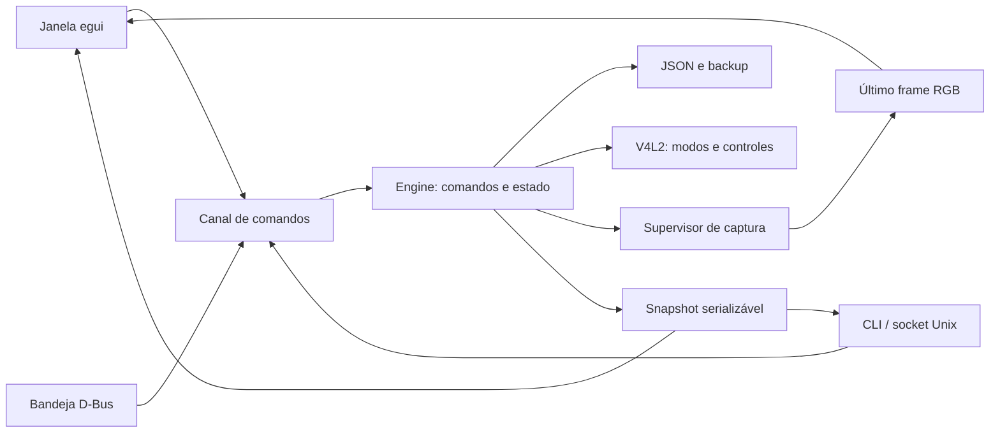

# Arquitetura do Facecam Hub

O mesmo controlador atende janela, bandeja e linha de comando. As interfaces
apresentam estado e enviam pedidos; descoberta, validação, persistência e captura
ficam fora da thread gráfica. A aplicação é Rust, com FFmpeg e V4L2 como serviços
locais de vídeo e ONNX Runtime opcional para inferência.

## Fluxo de dependências

`config`, `camera` e `effects` definem dados e limites. `stream` implementa
captura; `engine` coordena esses componentes. `ipc`, `gui`, `tray` e `main`
adaptam os comandos aos meios de interação. O núcleo não depende de egui.
Uma alteração de UI não deve criar outra implementação de Start, Stop ou Save.

O checkbox de inicialização no desktop envia `SetAutostart` ao controlador.
`desktop` cadastra/remove a entrada do usuário, e `autostart_enabled` publica o
estado confirmado do arquivo, consultado também na atualização periódica.
A GUI não grava arquivos de autostart diretamente. A preferência de abrir na
bandeja permanece em `config.ui.start_minimized`, persistida por `UpdateSettings`
a cada alteração. Esse comando atualiza apenas as preferências enviadas, salva
antes de publicar o estado e permite alterar o início na bandeja durante captura.
A troca de câmera virtual continua exigindo captura parada.

`i18n` carrega catálogos JSON com limites e placeholders verificados. O campo
`ui.language` nasce como `pt-BR`; `UpdateSettings.language` valida o catálogo e
salva antes de publicar a preferência e ativar as mensagens. A troca preserva
captura e rascunhos de efeitos. `Snapshot.languages` lista idiomas descobertos;
`Refresh` refaz essa lista. GUI, bandeja e mensagens humanas da CLI usam os
mesmos catálogos; enums, comandos, caminhos e nomes pessoais mantêm seus valores.
Consulte [Localização](LOCALIZACAO.md) para descoberta, fallback e contribuições.

## Comandos e estado

A atualização usa `CheckUpdates`, `InstallUpdate` e `RestartApp` no Engine.
`updater` executa Git/Cargo em worker, com saída em arquivo, limites de tempo e
processos próprios; `Snapshot.update` publica versão, fase, candidato e log.
Instalar/reiniciar exige captura parada e ausência de APT, importação ou preparo
RTX. Durante instalação, alterações operacionais e Quit são recusados. A consulta
pode ocorrer durante captura. A GUI instalada inicia apenas a consulta ao abrir.

`installation` publica um bundle imutável com manifesto e SHA-256, depois troca
`current` atomicamente. O mesmo helper do novo executável atende o script inicial
e o worker de atualização. Atalhos e autostart apontam ao launcher estável;
o processo anterior conserva seu binário e recursos até reiniciar. Modelos,
configuração e recursos pessoais ficam fora do pacote. Os 22 fundos originais
solicitados pelo usuário ficam em `resources/images` e `resources/videos` no bundle,
fora do executável. O instalador confere cada tamanho e SHA-256 antes da publicação;
script e atualizador fornecem os arquivos do mesmo checkout. O build headless mantém
consulta/protocolo e recusa a instalação desktop. Detalhes em
[Distribuição](DISTRIBUICAO.md).

`Request`, em `engine.rs`, é um enum serializável com discriminador `command`.
`Reply` traz `ok`, `message` e um `Snapshot`. O snapshot contém configuração,
câmeras, modo negociado, controles, disponibilidade, estado de captura, contagem
de frames e erros. Apenas o controlador modifica o estado operacional.

O socket aceita uma mensagem JSON por linha, com limite de 64 KiB por pedido.
O diretório pertence ao usuário e tem modo 0700. Uma trava impede que dois
controladores possuam a mesma instância. A thread processa pedidos e verifica
processos a cada 100 ms. A GUI recebe uma notificação para redesenhar quando
há mudança; não precisa consultar dispositivos em cada frame da janela.

Iniciar a janela sobre uma instância headless faz uma passagem controlada de
posse, retomando a saída virtual quando necessário. Parar ou sair encerra
somente filhos criados pelo aplicativo, sem procurar processos por nome.

## Captura e efeitos

O espelhamento da câmera é compartilhado pelas duas saídas. Com IA, `stream`
aplica `hflip` na captura RGB antes de enviar ao worker: segmentação e correção
de olhar recebem a câmera já espelhada. Imagens e vídeos substitutos entram depois,
na composição, mantendo a orientação original. O FFmpeg final não repete `hflip`.
Sem IA, o espelho permanece no grafo comum anterior ao split.

Sem IA, um processo FFmpeg captura o modo V4L2 negociado, aplica os efeitos e
divide o resultado entre a saída virtual e o preview opcional. LUT e ajustes
são calculados uma vez antes dessa divisão. Sem efeitos, o filtro é neutro.

Com IA, a captura produz RGB para um processo Rust de inferência; outro FFmpeg
recebe o RGB processado e executa os efeitos comuns e a divisão. Os pipes têm
capacidade limitada pelo sistema: não existe uma fila crescente de frames em
Rust. O worker mantém uma sessão ONNX e é encerrado junto com a captura.
A inferência CUDA não falha silenciosamente para CPU.

Antes do worker, preview e saída virtual mantêm a resolução original e usam
a mesma taxa, limitada por `ai_fps`
(padrão 30, até 60). O input rawvideo do segundo FFmpeg usa os FPS processados
e probing mínimo, pois dimensão e formato já são conhecidos.

A segmentação ONNX usa RGB float32 NCHW 1×3×256×256. O backend NVIDIA Ada usa
BGR 1×3×288×512 e seis estados temporais mantidos na GPU, com entradas e saídas
distintas. Ambos reescalam pixels para [0,1] e retornam alpha de pessoa.
`auto` testa NVIDIA isoladamente quando disponível, com fallback ONNX no mesmo
provider e aviso no snapshot. `nvidia` e `onnx` fixam o backend. O aquecimento
verifica uma inferência antes da troca. A composição preserva o primeiro plano e usa um fundo
reduzido e desfocado. O modelo é externo e tem contrato verificado no aquecimento.
Cor sólida, cenários ilustrados e imagem própria também podem substituir o fundo.
A imagem é decodificada com limites e preparada uma vez por worker.
Com CUDA, `gpu.rs` gera grafos ONNX próprios para redimensionar e normalizar a
entrada, desfocar o fundo, interpolar alpha e compor a imagem na GPU. O I/O
binding conecta os tensores de imagem, máscara e estados entre sessões sem
copiá-los para CPU. Fundos estáticos são enviados uma vez; vídeo envia cada
quadro novo. O RGB de captura entra na GPU e o RGB composto retorna para FFmpeg;
conversão YUV, filtros convencionais e apresentação continuam fora desse caminho.
Os grafos de processamento recusam fallback CPU. O modelo ONNX externo pode ter
operadores auxiliares em CPU; a segmentação temporal nativa usa TensorRT.
Na alternativa CPU explícita, a composição reutiliza geometria e um buffer de
interpolação horizontal. Não há troca automática de provider em caso de falha.
O worker isola carregamento e possíveis falhas nativas da janela/controlador.

Em modo de vídeo de fundo, o worker possui um decoder FFmpeg adicional em loop.
Ele recebe dimensão e FPS efetivos por argumentos tipados, aceita arquivos locais
e gera RGB por pipe limitado. Um pequeno modo interno do mesmo binário configura
a morte por encerramento do pai antes de executar FFmpeg, com APIs seguras de
`nix`. O encerramento normal mata e recolhe o decoder; morte abrupta do worker
também encerra o processo. O controlador mantém a posse da captura e do worker.

Os filtros convertem para yuv420p antes do split. O preview converte uma cópia
desses mesmos quadros para RGB24, em resolução nativa e sem limitador próprio.
`PreviewFrame` carrega dimensão e pixels; a GUI preserva a proporção e recebe
uma notificação a cada quadro. Somente o último quadro completo fica na caixa
de entrega; uma janela lenta não acumula histórico para exibir depois. O monitor
e o compositor ainda limitam a apresentação, e consumidores externos podem
aplicar suas próprias conversões ou espelhamento.
Sem IA, a taxa negociada é preservada. Com IA, vale o limite de FPS explícito
para ambas as saídas, inclusive em preview sem saída virtual. Fechar a janela com
bandeja disponível desliga o preview e mantém a saída virtual.

Em sessões com GUI, o ramo RGB de preview é reservado ao iniciar a captura.
`Stream::set_preview` alterna somente a publicação dos quadros; o leitor continua
escoando o pipe com buffer reutilizado quando oculto. A troca preserva processos,
uptime, worker de IA e saída virtual. `Preview` conserva uma saída virtual já
ativa. Um controlador headless iniciado sem preview conserva a variante sem RGB;
ativar preview pela primeira vez nesse caso ainda requer reconstruir o grafo.
As próximas alternâncias usam o pipe já aberto. Erros incluem somente o trecho
do log da captura atual, sem misturar avisos de encerramentos anteriores.

Aplicar efeitos verifica parâmetros, arquivos e inferência, interrompe brevemente
a captura, retoma as saídas anteriores e salva o JSON. Falhas síncronas restauram
a configuração anterior e tentam retomar a captura. Erros posteriores de FFmpeg
aparecem no estado; spawn bem-sucedido não comprova entrega de vídeo.

## Biblioteca de recursos

`resources` descobre Looks, imagens e vídeos nos diretórios conhecidos. O catálogo
e o progresso de importação pertencem ao snapshot. A GUI apresenta nomes e abre
o diálogo nativo; a escolha envia `ImportResource` ao controlador. Uma thread
valida e copia o arquivo para a biblioteca ao lado da configuração, publicando
o resultado somente após concluir. A importação não aplica efeitos nem salva JSON:
o rascunho visual seleciona o resultado, e `SetEffects` confirma o uso.
Só uma importação roda por vez; Quit é recusado até terminar. Miniaturas são
derivadas visuais, lidas em segundo plano pela GUI, sem alterar a biblioteca.
LUTs próprias são materializadas pelo controlador quando selecionadas. O build
headless mantém catálogo, importação e validação sem depender de egui ou ONNX.

`RemoveImage` remove apenas um arquivo regular diretamente em `resources/images`
da configuração deste controlador. Recusa symlinks, diretórios, caminhos externos
e remoção durante importação. O catálogo publica `removable`; a GUI usa esse estado
para habilitar a ação, mas a autorização é revalidada no núcleo. Se o arquivo
está na configuração, a referência é limpa e persistida antes da exclusão.
Com IA de imagem aplicada, `SetEffects` valida a troca para desfoque e retoma as
mesmas saídas. Falha de exclusão restaura os efeitos anteriores ou informa também
a falha de restauração. Uma imagem sem referência confirmada é removida sem salvar
configuração ou reiniciar a captura. O original da importação nunca é removido.

## Instalação de dependências

`PrepareNvidia` inicia `nvidia_setup` em segundo plano, com captura parada.
Ele prepara componentes no diretório de dados do usuário, sem operação
administrativa: download com hash, extração e importação limitada ao modelo
conhecido, runtime separado e inferência real em staging. Só depois publica
o diretório por rename; falha preserva os componentes anteriores. O snapshot
publica presença, progresso, execução e log. Iniciar captura ou sair durante
essa preparação é recusado. A GUI não executa downloads diretamente.
[Análise RTX](ANALISE_RTX.md) detalha arquivos, versões e limites.

`PrepareAr` usa a mesma fila, progresso e bloqueios de `PrepareNvidia`. O módulo
`nvidia_ar_setup` reutiliza o runtime VFX preparado e publica os quatro contratos
AR 0.8.7 Ada em diretório separado. O manifesto fixa versão, família, hash do pacote
e raiz do runtime. Descoberta limitada não carrega bibliotecas; o worker confere
os hashes dos engines normalizados e executa as quatro inferências antes da
publicação. Licenças acompanham os arquivos no usuário. Falha mantém o diretório
anterior; rename recusado tenta restaurá-lo. `Snapshot.ar_prepared` representa
presença, sem substituir inferência ou aceitação visual. O diagnóstico usa a preparação
persistente quando existe e conserva a alternativa temporária sem instalação.

`effects.eye_contact` ativa a correção de olhar no mesmo worker Rust.
`nvidia_framing` envia o RGB uma vez à GPU, prepara BGR com letterbox, executa a
detecção e devolve somente dois tensores pequenos à CPU. `framing` decodifica
caixas e suprime sobreposições. `gaze` valida landmarks, confiança e alinhamento
2D; `nvidia_gaze` executa amostragem, encoder/decoder e composição local na GPU.
Somente caixas, landmarks e diagnósticos escalares voltam à CPU. A imagem
corrigida alimenta diretamente a segmentação/composição quando o fundo está ativo;
sozinha, retorna RGB ao FFmpeg. O modo somente fundo mantém os grafos anteriores.
O aquecimento executa os modelos e zera o histórico antes dos frames reais.
O controlador valida e salva esse campo por `SetEffects`, preservando o mesmo
split, limite de FPS e rollback de falhas síncronas. Não recorta o vídeo nem
escreve PTZ físico. O antigo `auto_frame` é lido por compatibilidade, ignorado
operacionalmente e omitido na serialização; ele não liga a correção implicitamente.

`dependencies` prepara um plano APT sem modificar o sistema. `PrepareInstall`, `PrepareUninstall`,
`ConfirmInstall` e `CancelInstall` passam pelo mesmo controlador em GUI/CLI.
Somente um ID de plano atual pode ser confirmado, uma vez. A instalação roda
fora da thread do controlador, com comandos fixados pelo núcleo e autenticação
por `pkexec`; a senha não atravessa IPC. Não há um comando de shell arbitrário.
O estado publica plano, execução, resultado e log. Durante uma transação APT,
Quit é recusado e fechar a janela não encerra a aplicação.

O snapshot publica `dependencies` com presença e versão por pacote, obtidas pelo
`dpkg-query`, sem confundir arquivos residuais com pacote instalado. A consulta
ocorre na abertura, na atualização e a cada cinco segundos, mesmo durante captura.
Ao concluir a operação, o worker verifica o resultado no dpkg e o controlador
atualiza o snapshot; o botão decorre do estado real, sem flag salva na GUI.
`dependency_error` distingue falha de consulta de ausência de pacote.

A remoção simula o APT e limita o plano aos pacotes solicitados. Uma remoção de
outros pacotes é recusada; não há autoremove ou purge. A simulação é repetida no
worker antes da autenticação. Remover ferramentas de vídeo exige captura parada;
o controlador recusa iniciar preview/saída enquanto essa remoção estiver ativa.
As [semânticas de simulação e remove](https://manpages.debian.org/trixie/apt/apt-get.8.en.html)
e os [estados do dpkg](https://manpages.debian.org/trixie/dpkg/dpkg-query.1.en.html)
seguem as ferramentas de sistema. Uma alteração externa entre simulação e execução
continua sujeita ao controle de transações do APT; não há trava distribuída do app.

O SDK Manager usa o candidato dos repositórios existentes. Sem candidato, Ubuntu
24.04 x86-64 pode cadastrar uma fonte oficial NVIDIA em formato deb822, com chave
OpenPGP embutida em `Signed-By` e SHA-256 fixado. O cadastro ocorre após confirmação;
nenhum instalador `.deb` local é usado. Isso prepara uma dependência de sistema,
sem implementar um backend Maxine ou mudar o provider ONNX/CUDA.

## Contratos da câmera e persistência

`virtual_camera` consulta o kernel, modinfo e Secure Boot sem carregar módulos.
`PrepareVirtualCamera` produz um plano revisável, sem escrita administrativa.
Após `ConfirmInstall`, o worker usa uma única chamada pkexec ao modo restrito
`--virtual-camera-helper` do próprio binário, antes da inicialização de GUI/IPC.
O helper exige root, valida novamente kernel, dispositivo livre, pacotes permitidos
e arquivos do app. Ele gera as etapas internamente, sem ler scripts do usuário:
APT opcional, modprobe, dois arquivos persistentes opcionais e update-initramfs.
Os destinos são constantes e a escrita usa arquivo temporário e rename.
Cada erro interrompe a sequência; não há rollback de módulos ou APT.
Captura fica indisponível durante a preparação. O controlador verifica o driver,
as permissões e os arquivos persistentes e redescobre dispositivos ao concluir.
Não descarrega módulo existente, não desativa Secure Boot e não grava controles
na câmera física. [Uso](USO.md#preparar-a-câmera-virtual) descreve os limites.

O nó de captura é descoberto em sysfs e confirmado por V4L2; nós de metadados
são excluídos. Resolução, formato e FPS são escolhidos a partir dos modos reais.
Antes de escrever, são verificados intervalo, passo, menus e flags. A diferença
entre valores usa i128 para suportar todo o intervalo i64 sem overflow.

Depois da escrita, o valor do hardware é consultado novamente. Uma recusa nativa
fica associada à câmera atual, sobrevive à atualização automática e impede novas
escritas até atualização explícita ou troca do dispositivo. SAVE exclui esses
controles; Restore continua pelos demais. O intervalo anunciado não garante
que o firmware aceite uma escrita naquela configuração.

Configuração inválida permanece intacta. Campos adicionais na raiz são
preservados. O primeiro salvamento mantém um backup do arquivo existente e
escreve por arquivo temporário seguido de rename. Presets são locais ao usuário;
não representam gravação na memória interna da câmera.

## Extensão e limites

Um efeito novo precisa de parâmetros validados, execução no fluxo comum, comando
compartilhado e teste de saída. Aceleração deve declarar dependências e falhar de
forma visível. A compilação sem recursos padrão permanece útil sem bibliotecas
gráficas ou IA. Não há download automático na inicialização.

Firmware, outros controles USB proprietários e persistência
na câmera exigem investigação própria. A presença de um recurso no pacote macOS
não comprova seu protocolo nem sua disponibilidade em Linux.

## Prompter

`prompter.rs` contém parâmetros validados e avanço determinístico da leitura.
`Config.prompter` persiste roteiro/aparência; `Snapshot.prompter` publica reprodução,
posição e apresentação da sessão. `UpdatePrompter` salva antes de substituir os
parâmetros; texto diferente pausa e reposiciona. `ControlPrompter` e `SeekPrompter`
operam sem tocar no stream. O tick usa tempo monotônico e pausa após intervalos
superiores a dois segundos, evitando saltos após suspensão ou travamento.

`ReportPrompterDisplays` recebe a lista que o frontend nativo conhece. Mudanças
pausam e fecham a apresentação; `Show` recusa índice indisponível ou headless.
`prompter_gui.rs` somente desenha o texto e envia comandos. A janela egui deferred
é registrada também na lógica, continuando ativa com a raiz minimizada. O espelho
reflete a malha do nosso texto. Não existe ligação com os filtros da câmera.
A GUI evita atualizar sua textura de preview enquanto a aba Prompter está aberta.

## HDR da câmera

`hdr.rs` descobre a unidade pelo GUID em sysfs, restringe VID/PID e seletor e
valida metadados antes de escrever com uvcdynctrl. O código Rust não faz ioctl
inseguro. `Snapshot.hdr` representa leitura confirmada, pendência e ferramenta
ausente. `SetHdr` exige stream ativo, recusa ativar acima de 60 fps e espera o
valor solicitado; `0xff` provoca espera limitada, nunca sucesso como booleano.
A GUI só envia pedidos e prepara `HdrTools` pelo mesmo fluxo APT existente.

`Config.saved_hdr` nasce como null. Save lê e salva somente HDR confirmado;
falha de gravação não substitui os ajustes locais em memória. Restore aplica
HDR antes dos controles comuns quando a mudança é possível e informa um HDR
indisponível como item pulado. A GUI acompanha o valor salvo para não perdê-lo
ao alterar o formato. [HDR](HDR.md) mantém os parâmetros e a evidência do protocolo.
