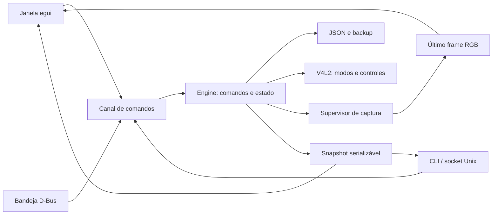

# Arquitetura do Facecam Hub

O mesmo controlador atende janela, bandeja e linha de comando. As interfaces
apresentam estado e enviam pedidos; descoberta, validação, persistência e captura
ficam fora da thread gráfica. A aplicação é Rust, com FFmpeg e V4L2 como serviços
locais de vídeo e ONNX Runtime opcional para inferência.

## Fluxo de dependências

`config`, `camera` e `effects` definem dados e limites. `stream` implementa
captura; `engine` coordena esses componentes. `ipc`, `gui`, `tray` e `main`
adaptam os comandos aos meios de interação. O núcleo não depende de egui.
Uma alteração de UI não deve criar outra implementação de Start, Stop ou Save.

## Comandos e estado

`Request`, em `engine.rs`, é um enum serializável com discriminador `command`.
`Reply` traz `ok`, `message` e um `Snapshot`. O snapshot contém configuração,
câmeras, modo negociado, controles, disponibilidade, estado de captura, contagem
de frames e erros. Apenas o controlador modifica o estado operacional.

O socket aceita uma mensagem JSON por linha, com limite de 64 KiB por pedido.
O diretório pertence ao usuário e tem modo 0700. Uma trava impede que dois
controladores possuam a mesma instância. A thread processa pedidos e verifica
processos a cada 100 ms. A GUI recebe uma notificação para redesenhar quando
há mudança; não precisa consultar dispositivos em cada frame da janela.

Iniciar a janela sobre uma instância headless faz uma passagem controlada de
posse, retomando a saída virtual quando necessário. Parar ou sair encerra
somente filhos criados pelo aplicativo, sem procurar processos por nome.

## Captura e efeitos

Sem IA, um processo FFmpeg captura o modo V4L2 negociado, aplica os efeitos e
divide o resultado entre a saída virtual e o preview opcional. LUT e ajustes
são calculados uma vez antes dessa divisão. Sem efeitos, o filtro é neutro.

Com IA, a captura produz RGB para um processo Rust de inferência; outro FFmpeg
recebe o RGB processado e executa os efeitos comuns e a divisão. Os pipes têm
capacidade limitada pelo sistema: não existe uma fila crescente de frames em
Rust. O worker mantém uma sessão ONNX e é encerrado junto com a captura.
A inferência CUDA não falha silenciosamente para CPU.

A segmentação usa RGB float32 NCHW 1×3×256×256, reescala para [0,1] e retorna
alpha de pessoa. A composição preserva o primeiro plano e usa um fundo
reduzido e desfocado. O modelo é externo e tem contrato verificado no aquecimento.
O worker isola carregamento e possíveis falhas nativas da janela/controlador.

O preview é RGB 640×360 a 15 fps e mantém somente o último frame completo.
A saída virtual preserva a resolução e a taxa negociadas. Fechar a janela com
bandeja disponível desliga o preview e mantém a saída virtual.

Aplicar efeitos verifica parâmetros, arquivos e inferência, interrompe brevemente
a captura, retoma as saídas anteriores e salva o JSON. Falhas síncronas restauram
a configuração anterior e tentam retomar a captura. Erros posteriores de FFmpeg
aparecem no estado; spawn bem-sucedido não comprova entrega de vídeo.

## Contratos da câmera e persistência

O nó de captura é descoberto em sysfs e confirmado por V4L2; nós de metadados
são excluídos. Resolução, formato e FPS são escolhidos a partir dos modos reais.
Antes de escrever, são verificados intervalo, passo, menus e flags. A diferença
entre valores usa i128 para suportar todo o intervalo i64 sem overflow.

Depois da escrita, o valor do hardware é consultado novamente. Uma recusa nativa
fica associada à câmera atual, sobrevive à atualização automática e impede novas
escritas até atualização explícita ou troca do dispositivo. SAVE exclui esses
controles; Restore continua pelos demais. O intervalo anunciado não garante
que o firmware aceite uma escrita naquela configuração.

Configuração inválida permanece intacta. Campos adicionais na raiz são
preservados. O primeiro salvamento mantém um backup do arquivo existente e
escreve por arquivo temporário seguido de rename. Presets são locais ao usuário;
não representam gravação na memória interna da câmera.

## Extensão e limites

Um efeito novo precisa de parâmetros validados, execução no fluxo comum, comando
compartilhado e teste de saída. Aceleração deve declarar dependências e falhar de
forma visível. A compilação sem recursos padrão permanece útil sem bibliotecas
gráficas ou IA. Não há download automático na inicialização.

Firmware, controles USB proprietários, HDR proprietário, Prompter e persistência
na câmera exigem investigação própria. A presença de um recurso no pacote macOS
não comprova seu protocolo nem sua disponibilidade em Linux.
