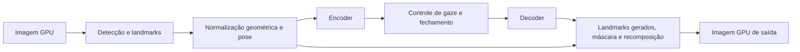

# Correção de olhar: caminho Windows e lacunas da implementação

O efeito atual é funcional, mas a qualidade foi recusada pelo usuário em vídeo.
Executar encoder e decoder não reproduz o recurso completo do Camera Hub.
Este levantamento registra o caminho rastreado e os contratos que ainda precisam
ser fechados antes de outra revisão visual.

## Escopo e evidências

Revisão de 26/10/2026, comparando `f9939eb` com Camera Hub Windows 2.3.0.7295 e
os pacotes AR Ada 0.8.2 e 0.8.7 já disponíveis localmente. Foram examinados
inicialização, I/O, processamento, configuração, seis estágios do efeito,
bindings, encerramento, imports e auxiliares de geometria e composição.

| Artefato | SHA-256 |
| --- | --- |
| Camera Hub, `ExeFile` | `c66fde57de800dccd539ee5f42a52624124ef0769765aadc7320ab43d5f96d88` |
| AR 0.8.2 Ada, `nvARPose.dll` | `659f4c30f1d7c5a459e25b9f62fe0d49282079872260c8f7ec16b0f4b3101010` |
| AR 0.8.7 Ada, `nvARPose.dll` | `90f8b1b4747349651621bc9a991c8f856664843f5315870677c485dbaadcc9a4` |

O método foi inspeção estática de PE, referências RIP relativas, limites da
tabela de exceções x64, dispatch por vtable e decompilação dirigida sem
autoanálise global. Não houve execução do Camera Hub ou das DLLs Windows.
Chamadas indiretas e funções auxiliares ainda exigem conferência de instruções;
o levantamento não equivale a reconstituir todo o SDK nem todos os seus kernels.

O manifesto local `target/ar-gaze-contract/review/manifest.json` identifica
origens e funções examinadas. As evidências ficam nos subdiretórios `app`,
`ar082`, `ar087`, `ar082-stages` e `ar087-stages`, fora do Git. Código decompilado,
pesos, templates, shaders e imagens pessoais não acompanham esta documentação.

## O que o Camera Hub entrega ao SDK

O carregador `0x141eb3c80` resolve a DLL dinamicamente. O pacote AR 0.8.2 é a
referência distribuída já inventariada; a DLL efetivamente instalada no Windows
do usuário não foi medida. A implementação Linux atual usa AR 0.8.7. Não se
pode atribuir uma diferença visual somente à versão sem comparar o mesmo caminho.

| Etapa no Camera Hub | Endereço | Comportamento confirmado |
| --- | --- | --- |
| Padrões do objeto de efeitos | `0x141eb0ef0` | Redireção habilitada, sensibilidade 3, tamanho de landmarks 68 e flags de CUDA habilitadas |
| Criação | `0x141ea68f0` | Cria `GazeRedirection`, define ModelDir, tamanho de landmarks, Temporal, GazeRedirect, stream, UseCudaGraph e EyeSizeSensitivity antes de carregar |
| I/O | `0x141ea6060` | Registra imagem de entrada/saída, dimensões e buffers de landmarks, confiança, pose, direção e translação |
| Execução GPU | `0x141ea5540` | Prepara a imagem, chama o proxy de `NvAR_Run` e transfere o resultado para a saída |
| Proxy Run | `0x141eb4300` | Resolve e chama a função do SDK |
| Liberação AR | `0x141ea5280` | Integra o encerramento dos recursos AR ao ciclo do filtro |

Os valores acima são os padrões recuperados do construtor, não uma leitura das
preferências efetivamente salvas na máquina Windows do usuário.

| Parâmetro | Origem e valor observado | Diferença para o caminho Rust atual |
| --- | --- | --- |
| `Landmarks_Size` | Camera Hub inicia com 68 | Usa o modelo genérico de 126 pontos |
| `Temporal` | Camera Hub configura `0xffffffff` | Filtragem própria de transformação e máscara; não reproduz todos os estados do SDK |
| `EyeSizeSensitivity` | Camera Hub e padrão SDK 0.8.2: 3 | Não implementa a semântica desse nível do SDK |
| `GazeRedirect` | Padrão habilitado | Habilitado pelo efeito `eye_contact` |
| `UseCudaGraph` | Flag habilitada no construtor; enviada ao SDK | ORT/CUDA/TensorRT próprios, sem equivalência demonstrada do agendamento |
| `DetectClosure` | Padrão SDK 0.8.2: 1; não foi observada escrita explícita na criação do Camera Hub | Razão geométrica simples da abertura das pálpebras |
| `BatchSize` | Padrão SDK 0.8.2: 1 | Seleciona um rosto |
| `ModelDir` e `CUDAStream` | Resolvidos/configurados pelo Camera Hub | Modelos importados e stream gerenciado pelas sessões nativas |

A I/O do SDK 0.8.2 exige imagem BGR U8 em memória GPU no caminho examinado.
O pré-processamento converte o recorte para RGB float antes do encoder.
Esses domínios são diferentes: observar BGR na entrada da API não basta para
concluir que o tensor do encoder deve ser BGR. As organizações planar/intercalada
e os tipos pertencem ao contrato [NvCVImage](https://docs.nvidia.com/maxine/nvcvimage/1.0.0/enumerations.html).

O [manual AR 0.8.2](https://docs.nvidia.com/deeplearning/maxine/pdf/ar-sdk-programming-guide.pdf)
confirma a entrada BGR U8 intercalada em CUDA. Especifica `HeadPose` como
quaternion XYZW obtido por PnP sobre os landmarks, além de translação 3D e gaze
estimado. Esses dados não equivalem diretamente aos três números do tensor
`headpose` do modelo 126 usado atualmente. O mesmo manual define sensibilidade
2–5 como escolha do tamanho da região ocular e inclui detecção de oclusão no
controle de fechamento.

## Os seis estágios dentro do recurso

O construtor Gaze do AR 0.8.2, `0x180023180`, cria seis objetos; o Run
`0x180026f70` os executa nessa ordem. No AR 0.8.7, o construtor correspondente
é `0x180049d40` e o Run é `0x1800521e0`. Os métodos abaixo foram identificados
pelos objetos e suas vtables, além dos nomes de parâmetros e modelos.

| Estágio | Run AR 0.8.2 | Run AR 0.8.7 | Contrato observado | Situação em `f9939eb` |
| --- | --- | --- | --- | --- |
| Landmarks | `0x18002edb0` | `0x1800546a0` | Repassa pontos, confiança e dados usados nos estágios seguintes; pode rodar detecção interna ou receber pontos externos | Detector e landmarks 126 conectados; não corresponde ao padrão de 68 pontos do Camera Hub |
| Pré-processamento | `0x180030660` | `0x180058d10` | Normalização do rosto, matrizes de rotação/warp, pose/translação, decisões de fechamento e recorte para o encoder | Similaridade 2D frontal própria baseada nos centros dos olhos |
| Encoder | `0x180034c00` | `0x18005df30` | Extrai embeddings e pseudo-labels do recorte RGB normalizado | Executa o modelo com contratos de forma validados |
| Controle intermediário | `0x180035b90` | `0x180060250` | Consome rotação, pose e features; decide redireção/pós-processamento e prepara o comando de gaze | Não reproduz esse estágio; passa embeddings e labels diretamente ao decoder |
| Decoder | `0x1800372a0` | `0x180061ef0` | Produz imagem redirecionada e 12 landmarks dos olhos | Usa alvo constante `(0,0)` e somente a imagem gerada |
| Pós-processamento | `0x180038b10` | `0x180064ea0` | Usa geometria original e gerada, constrói máscaras e recompõe na imagem original | Composição por elipses próprias, sem utilizar os landmarks gerados |

### Detecção e versão dos modelos

O AR 0.8.2 contém `face_detection_89`, `gaze_landmarks_fp16_89`, os dois
`gazeredir_*` e outros modelos de landmarks/recursos. O estágio de landmarks
Gaze, para 68 pontos, configura o modo `0x31`; o seletor de modelos nesse caso
escolhe `gaze_landmarks_fp16`. Endereços: configuração `0x18002ee90`, seleção
`0x180010660`. A lista do instalador AR 0.8.7 não contém esse arquivo dedicado;
contém outras variantes de landmarks e os dois modelos de redireção.

O preparador atual fixa quatro engines AR 0.8.7, incluindo
`faceland_126_maxbatch1_mode0_89`. Ter o mesmo número de canais na imagem de
saída não demonstra equivalência de pose, pontos, espaço de normalização ou
controle temporal entre esses caminhos. Trocar somente o arquivo do modelo
ou somente o número de pontos também não fecha esse contrato.

### Normalização e tratamento temporal

O pré-processamento do SDK trabalha com rotação, translação e uma matriz de
warp; a projeção de gaze também usa essa transformação. O ajuste geométrico
principal examinado no 0.8.2 é `0x180030f10`. Sua substituição por uma
similaridade 2D foi uma simplificação da implementação Linux, não uma
equivalência comprovada.

O Run 0.8.2 publica `Internal_OneEuroSampleRate`; pré-processamento, controle
intermediário e pós-processamento consomem esse parâmetro. Isso confirma uma
interface temporal compartilhada. Os coeficientes, variáveis filtradas, política
de reset e frequência efetiva precisam ser recuperados e testados por estágio;
o nome do parâmetro não basta para afirmar que nossa EMA implementa o mesmo filtro.

O controle intermediário possui estado e contadores, considera fechamento e
condições de pose/gaze e decide `Internal_DoRedirectionAndPostProcessing`.
Também produz `Internal_GazePOR`. Essa etapa fica entre encoder e decoder;
um alvo constante ignora decisões que influenciam a naturalidade do efeito.

A [descrição técnica da NVIDIA](https://developer.nvidia.com/blog/improve-human-connection-in-video-conferences-with-nvidia-maxine-eye-contact/)
também apresenta normalização por pose 6DOF, extração 256×64 e transformação
dos fatores latentes relacionados ao gaze antes da reconstrução. Descreve
atenuação conforme o olhar se afasta do centro e desativação fora da faixa de
pose suportada. Essa descrição corrobora a necessidade de reconstruir o estágio
de controle; não fornece os coeficientes internos dos binários examinados.

### Landmarks gerados e máscara

O pós-processamento 0.8.7 converte coordenadas geradas para o recorte como
`x = 256*u + 128` e `y = 64*v + 32`, antes de usar a geometria original.
A ordem observada é primeiro os 12 X, depois os 12 Y. Isso não é a conversão
`align_corners` usada pela amostragem de uma imagem; é um contrato de pontos.

Na fotografia pública já usada nos testes, os centros dos cantos dos olhos na
entrada foram colocados em `(64,32)` e `(192,32)`. O decoder devolveu centros
aproximados `(63,18; 28,46)` e `(193,45; 28,41)` nesse espaço. Há deslocamento
geométrico mesmo nesse exemplo frontal. O teste anterior verificava alteração
local e preservação externa, mas não verificava o encaixe desses contornos.
Evidência numérica local: `target/ar-gaze-contract/review/decoder-landmarks.log`.

No SDK 0.8.2, o pós-processamento `0x180038b10` usa os pontos originais e
gerados; os auxiliares `0x18003c200`, `0x18003d2a0` e `0x180039470` participam
da construção, processamento e transformação da máscara e da composição.
Os thunks de importação confirmam união (`nppiOr_8u_C1R_Ctx`), dilatação
(`nppiDilateBorder_8u_C1R_Ctx`) e suavização gaussiana
(`nppiFilterGaussBorder_8u_C1R_Ctx`), além da transformação de perspectiva.
Essa cadeia não foi reproduzida pelas elipses atuais. O deslocamento observado
é evidência de uma lacuna de encaixe; sem entrada original pareada, não isola
a causa de cada artefato da gravação do usuário.

## Bibliotecas e recursos associados

A DLL AR 0.8.2 importa `NVCVImage.dll`, `NVTRTLogger.dll`, `cudart64_110.dll`,
`cublasLt64_11.dll`, famílias NPP 11, `cufft64_10.dll`, `nvinfer.dll` e
`libcrypto-1_1-x64.dll`, além do runtime Windows/C++. Na 0.8.7 aparecem as
dependências correspondentes CUDA/NPP 12, `nvinfer_10.dll` e OpenSSL 3.
Esses são imports da biblioteca inteira: nem toda função importada foi
demonstrada no caminho quente deste efeito.

O inventário dos instaladores também contém malhas e materiais de outros
recursos. Presença no pacote não os torna automaticamente necessários ao Gaze.
Cada recurso precisa de uma ligação comprovada ao caminho escolhido, com origem,
licença e contrato de leitura. Nenhum dado proprietário deve ser incorporado ao
Git como substituto de uma implementação própria.

## Critérios para a próxima implementação

| Entrega necessária | Verificação que falta |
| --- | --- |
| Fixar versão e modo de landmarks | Inventário do caminho escolhido, formas e correspondência dos pontos; compatibilidade real do runtime |
| Fechar a normalização geométrica | Projeção e inversa, eixos, intrínsecos, pose, escala e recorte; oráculos com movimento e rosto inclinado |
| Reproduzir o controle entre encoder e decoder | GazePOR e transformações de features, fechamento/oclusão, sensibilidade, estados, transições e resets |
| Fechar os filtros temporais | Variáveis filtradas, frequência, coeficientes, inicialização e perda/reaquisição |
| Usar corretamente os contornos gerados | Alinhamento entre entrada e saída e encaixe de pálpebras/íris; máscara por geometria compatível |
| Validar composição e cor | Ordem dos canais, profundidade, interpolação, dilatação, blur e preservação fora da máscara |
| Aceitar qualidade | Entrada original pareada e saída processada; vídeo real com leitura, piscadas, olhos abertos, pose, movimento e iluminação |

A gravação pessoal fornecida mostra a saída já corrigida e foi inspecionada
localmente. Ela não permite medir diretamente a diferença para a entrada original
nem serve como fixture distribuída. Aplicar o efeito novamente ao preview gravado
seria dupla correção, não uma validação da próxima implementação.

O estado segue **funcional, qualidade recusada no ensaio do usuário**. Os testes
de contrato e os builds anteriores continuam evidência de execução e estabilidade
de processo; não constituem aceitação de naturalidade ou paridade Windows.
