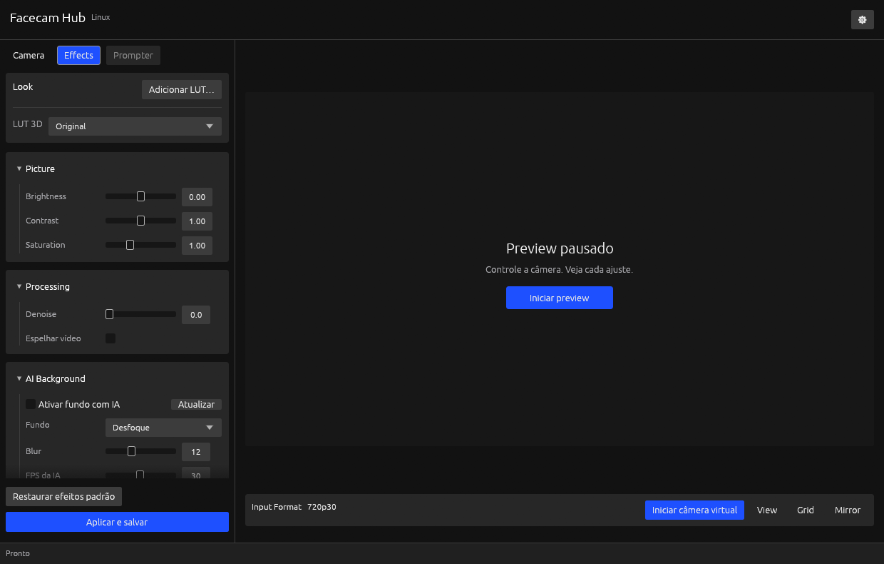

# Efeitos de vídeo e IA

Os controles da aba Camera alteram a câmera pelo V4L2. A aba Effects transforma
os frames no computador. Os efeitos são aplicados antes da separação entre
preview e câmera virtual, inclusive quando a janela está na bandeja.



**Efeitos** organiza os ajustes em cards: **Visual** para a LUT, **Imagem** para
brilho/contraste/saturação, **Processamento** para denoise e espelho, e **Fundo com IA**
para fundo, FPS e estado da IA. Clique no título dos cards de parâmetros para
recolher ou expandir. Rótulos, sliders e valores seguem as mesmas colunas da aba
**Câmera**. Os detalhes de provider ficam em **Opções avançadas**, inicialmente
recolhido. O botão **Aplicar e salvar** permanece no rodapé durante a rolagem.

## Efeitos comuns

| Campo JSON | Padrão | Valores |
| --- | --- | --- |
| `mirror` | false | Espelha a câmera nas duas saídas; preserva a orientação da imagem/vídeo de fundo |
| `brightness` | 0 | -1 a 1 |
| `contrast` | 1 | 0 a 2 |
| `saturation` | 1 | 0 a 3; zero remove cor |
| `denoise` | 0 | 0 a 10; zero desliga o filtro hqdn3d |
| `lut` | vazio | Caminho completo para LUT 3D `.cube` |
| `background_blur` | false | Ativa efeitos de fundo com IA; nome mantido por compatibilidade |
| `background_mode` | blur | `blur`, `solid`, `studio`, `office`, `landscape`, `image`, `video` |
| `background_color` | [32,38,48] | Três canais RGB u8 para `solid` |
| `background_image` | vazio | Caminho interno de PNG, JPEG, WebP ou BMP para `image` |
| `background_video` | vazio | MP4/MOV/WebM/MKV local não vazio, até 4 GiB, para `video` |
| `ai_fps` | 30 | 1 a 60; limite da saída virtual com IA |
| `blur_radius` | 12 | 1 a 32, no fundo reduzido: 256×256 ONNX ou 512×288 NVIDIA |
| `ai_provider` | cuda | `cuda` ou `cpu`, escolha explícita |
| `ai_backend` | auto | `auto`, `onnx` ou `nvidia`; seleção NVIDIA não altera o provider |
| `ai_model` | detectado quando disponível | Caminho completo para modelo ONNX |
| `ai_runtime` | detectado quando disponível | Caminho completo para `libonnxruntime.so` |

Valores não finitos e fora do intervalo são recusados. Na GUI, altere os campos
e clique **Aplicar e salvar**. Um arquivo de efeitos para CLI contém somente
os campos da tabela; os demais assumem o padrão:

```json
{
  "brightness": -0.05,
  "contrast": 1.1,
  "saturation": 1.05,
  "denoise": 2.0,
  "mirror": false,
  "lut": "/home/usuario/Imagens/minha-lut.cube"
}
```

Com a GUI ou controlador headless em execução:

```bash
./target/release/elgato-virtualcam --set-effects effects.json
```

O pedido `set_effects` também está disponível no socket. Ele valida os valores,
verifica os arquivos e, quando IA está ativa, executa um aquecimento real antes
de interromper a captura atual. Aplicar reinicia as saídas que estavam ativas.
A configuração é salva no controlador, mesmo se o CLI usar outro `--config`.
As ações **Restaurar efeitos padrão** e **Aplicar e salvar** ficam no rodapé fixo
do painel; abrir opções avançadas não oculta o botão de aplicar.

O provider padrão é NVIDIA CUDA. A opção **CPU (alternativa)** fica dentro de
**Opções avançadas** e usa ONNX Runtime. Essa alternativa não reproduz o contrato
dos efeitos NVIDIA VFX/AR do Camera Hub Windows, que exigem RTX e seus SDKs.
Nenhuma falha de CUDA muda automaticamente para CPU.

## Escolher o fundo e a taxa de processamento

Ative **Ativar fundo com IA**. O seletor oferece desfoque, cor sólida, três
cenários ilustrados locais, **Minha imagem** e **Meu vídeo**. Esses dois últimos
seletores incluem as 15 imagens e os sete vídeos originais do Camera Hub Windows
2.3.0.7295, conforme solicitado pelo usuário. Escolha o nome do arquivo e clique
em **Aplicar e salvar**. A [proveniência dos fundos](../assets/backgrounds/README.md)
registra os arquivos sem conversão. Os três cenários ilustrados são opções próprias. A composição usa a mesma máscara de
pessoa, antes do split entre preview e saída virtual. Imagens estáticas são
decodificados uma vez por worker, redimensionados para preencher a saída com
recorte central e mantidos em memória; não são lidos novamente por frame.

Aceitamos PNG, JPEG, WebP e BMP, até 32 MiB, dimensões até 8192×8192 e orçamento de
decodificação de 128 MiB. Imagem ausente ou inválida falha no aquecimento antes
de substituir a configuração ativa. Use imagens locais em que confia.

**Adicionar imagem…**, **Adicionar vídeo…** e **Adicionar LUT…** abrem o seletor
do desktop, sem bloquear a captura. A interface mostra nomes e miniatura do fundo,
sem campos de caminho. A importação valida e copia o recurso para a biblioteca
do app em segundo plano; um arquivo recusado não altera a configuração salva.
O arquivo importado fica selecionado no rascunho até **Aplicar e salvar**.
Em **Minha imagem**, **Remover imagem** exclui imediatamente a cópia selecionada
da biblioteca gravável, preservando o original. O botão só fica disponível para
imagens gerenciadas por esta instância. Remover uma imagem aplicada troca o fundo
para desfoque pelo controlador, valida a troca e salva antes da exclusão. Falha
de exclusão tenta restaurar a seleção anterior; falha da troca preserva o arquivo.
Remover uma imagem não aplicada não confirma os outros efeitos do rascunho.
Para vídeo, escolha **Meu vídeo** e um MP4, MOV, WebM ou MKV local. A reprodução é em
loop, sem áudio, com recorte central para preencher o quadro. Um decoder FFmpeg
por worker fornece RGB na taxa efetiva de processamento, igual para preview e
saída virtual, inclusive em modos fracionários. O pipe aplica contrapressão; o arquivo
inteiro não é carregado em memória. Mídia inválida é recusada no aquecimento.
O decoder é recolhido no encerramento normal e recebe SIGKILL se o worker morrer.

`ai_fps` limita a taxa processada de preview e saída virtual, com padrão 30. É independente
do modo anunciado pela câmera; com entrada 1080p60 e limite 30, a saída com IA é
1080p30. Sem IA, a taxa negociada é preservada. Preview sem saída virtual usa
a mesma resolução, taxa e composição que terá ao iniciar essa saída. O rodapé
**Saída** mostra resolução e taxa configuradas para ambas. Um limite de 60 não
garante que o hardware ou o monitor apresente 60 frames por segundo.

Para privacidade, uma substituição opaca esconde mais detalhes que desfoque.
A segmentação continua sujeita a falhas; nenhuma opção garante recorte perfeito.

## Preparar a IA

Para RTX 40/Ada, pare a captura e abra **Configurações** › **Efeitos NVIDIA RTX** ›
**Preparar IA RTX**. O app reutiliza o pacote de referência quando disponível em
Downloads, obtém as dependências e testa a inferência antes de publicar a instalação.
Não exige caminhos manuais nem executa instaladores Windows. Também não modifica
o driver ou instala pacotes no sistema. A preparação pode baixar vários GB.
Requer `7z`, `curl`, `tar`, `dpkg-deb`, `unzip`, `setpriv` e o helper APT do Ubuntu.
Progresso e caminho do log aparecem nas configurações.
Se as ferramentas de download/extração faltarem, o mesmo botão apresenta um plano
APT para `curl`, `p7zip-full` e `unzip`. Confirme a instalação e, ao concluir,
clique novamente em **Preparar IA RTX**. Essa etapa administrativa usa o fluxo
de autenticação do Ubuntu; os componentes de inferência continuam no usuário.

O backend **Automática** prefere a segmentação temporal NVIDIA quando preparada
e validada. Se a inicialização falhar, tenta ONNX com o mesmo provider e mostra o
motivo. **NVIDIA RTX** exige esse backend; **ONNX** força a alternativa anterior.
A seleção fica em **Opções avançadas**. Falha durante captura encerra o stream
com erro, sem trocar para CPU. [Análise RTX](ANALISE_RTX.md) define a combinação
exata suportada e seus limites; outras famílias continuam pelo ONNX disponível.

Ao abrir `./target/release/elgato-virtualcam`, modelo e runtime
são detectados nos locais conhecidos, sem edição de paths na GUI. Não é necessário `--config`
para usar a instalação padrão ou os arquivos preparados em `target/ai-runtime`.
O aplicativo não baixa arquivos nem ativa IA nessa busca.

## Descoberta automática

A prioridade é: caminho já configurado; `FACECAM_AI_MODEL` e `FACECAM_AI_RUNTIME`;
registro do preparador; diretório de dados do usuário; instalação junto do
executável; diretório de desenvolvimento; locais de sistema. Cada campo é
preenchido independentemente e apenas quando vazio. Caminhos manuais inexistentes
continuam preservados no JSON, para que um erro não seja mascarado por outra instalação.

O diretório padrão é `${XDG_DATA_HOME:-~/.local/share}/facecam-hub/ai`. O preparador
registra também instalações feitas com `--directory` em
`facecam-hub/ai-installations.json` no diretório de dados. O registro mantém
entradas CPU e CUDA, sem modificar `config.json`.

Junto do executável, a busca inclui `ai/`, `lib/`, `share/facecam-hub/ai` e
`ai-runtime/` nos níveis de instalação conhecidos. Na árvore de desenvolvimento,
isso encontra `target/ai-runtime/` mesmo quando o executável é chamado de outra
pasta. Há pistas relativas ao diretório de trabalho e em `/usr/local`, `/usr`
e `/opt/onnxruntime`. Não há varredura recursiva do disco ou da pasta pessoal.

O modelo conhecido é `selfie.onnx`, com alternativas de subpasta documentadas
no módulo `ai_paths`. O runtime pode estar em `lib/` ou em um pacote
`onnxruntime-*`. São aceitos o link `libonnxruntime.so`, `.so.1` e arquivos
versionados. Dentro do mesmo local, pacotes do provider selecionado têm
preferência, depois versões mais novas. Outro pacote disponível pode preencher o
campo sem alterar o provider: encontrar runtime CPU não faz CUDA passar a usar CPU.

Se preparou arquivos com a janela aberta, clique em **Atualizar** na aba
**Efeitos**, ou use a atualização de dispositivos. Configurações antigas com
caminhos explícitos continuam compatíveis; para voltar à detecção, remova esses
campos do JSON com o app fechado. A GUI apresenta disponibilidade, sem caminhos editáveis.

## Biblioteca de Looks e fundos

O seletor **Visual** oferece **Original** e três LUTs próprias: **Quente**, **Frio** e
**Contraste suave**. São transformações originais geradas localmente quando aplicadas;
não são LUTs extraídas do Camera Hub. Arquivos `.cube` importados devem ser texto
UTF-8 até 16 MiB, com `LUT_3D_SIZE` de 2 a 65, exatamente N³ cores RGB finitas e
domínio válido. Valores negativos e acima de 1 são aceitos; NaN e infinito são recusados.
LUTs 1D e combinações com shaper 1D não são aceitas.

A biblioteca gravável fica em `resources/` ao lado do `config.json`, com subpastas
`luts/`, `images/` e `videos/`. A descoberta também consulta
`${XDG_DATA_HOME:-~/.local/share}/facecam-hub/resources`, `resources/` junto do
executável, `/usr/local/share/facecam-hub/resources` e `/usr/share/facecam-hub/resources`.
Arquivos selecionados em configurações antigas aparecem pelo nome. A varredura
não percorre a pasta pessoal: lê até 256 entradas por subpasta, publica até 128
recursos e limita o catálogo a 64 KiB estimados para preservar a resposta IPC.
Use **Atualizar** após instalar recursos externamente.

A importação usa uma cópia temporária oculta, valida o conteúdo e publica sem
sobrescrever arquivos existentes. Nomes repetidos recebem um sufixo. Falhas removem
a cópia parcial; o original é preservado. Não há exclusão automática, deduplicação
por conteúdo ou sincronização com o arquivo de origem. Miniaturas usam o primeiro
frame local via FFmpeg, fora da thread gráfica; não são uma reprodução do vídeo.

Descoberta comprova presença, não compatibilidade ou integridade do binário nativo.
A validação por inferência continua ocorrendo ao ativar IA e por `--check-ai`.
O usuário precisa selecionar CPU explicitamente se esse for o provider desejado.

## Modelo e runtime compatíveis

A alternativa ONNX usa **ONNX Runtime 1.22.0**, acessado por `ort` 2.0.0-rc.9
(API 20). NVIDIA usa runtime separado 1.20.1 com TensorRT 10.4.0.26.
O modelo de referência compatível é a conversão ONNX da segmentação Selfie
MediaPipe, revisão `be49485c8e027524be38591817fc5cd31bd9d00e`:

- [Modelo e licença Apache-2.0](https://huggingface.co/onnx-community/mediapipe_selfie_segmentation).
- [Runtime oficial 1.22.0](https://github.com/microsoft/onnxruntime/releases/tag/v1.22.0).
- [Dependências CUDA e cuDNN](https://onnxruntime.ai/docs/execution-providers/CUDA-ExecutionProvider.html).

Execute o preparador para baixar os arquivos em um diretório local do usuário,
sem sudo, sem instalar Python e sem modificar o driver:

```bash
./prepare-ai.sh --cpu
# Ou, para NVIDIA CUDA (download e espaço em disco significativamente maiores):
./prepare-ai.sh --cuda
```

O preparador atende Linux x86_64 e exige `curl`, `jq`, `tar` e `unzip`. As versões são fixadas; o script
confere SHA-256 e preserva as licenças dos pacotes baixados. Use `--directory`
para outro diretório. Ao terminar, ele informa o arquivo de efeitos criado e
os comandos para abrir a aplicação e aplicar os efeitos. As bibliotecas CUDA
preparadas nessa estrutura são localizadas pelo worker; não é preciso alterar
o ambiente da sessão. Modelo e runtime são detectados automaticamente; ative o fundo com IA
e aplique na UI, ou use o JSON pela CLI.

O contrato do modelo é um único tensor RGB float32 NCHW, batch 1 (ou batch
dinâmico), 3×256×256, com pixels divididos por 255. A saída é uma máscara de
pessoa 256×256, entre 0 e 1. Não use um modelo arbitrário com os mesmos nomes:
normalização e significado do alpha também precisam corresponder.

Para uma configuração manual, acrescente `effects` ao arquivo principal:

```json
{
  "effects": {
    "background_blur": true,
    "ai_provider": "cuda",
    "ai_model": "/caminho/selfie.onnx",
    "ai_runtime": "/caminho/onnxruntime/lib/libonnxruntime.so"
  }
}
```

Valide antes de abrir captura:

```bash
./target/release/elgato-virtualcam --config config-ai.json --check-ai
```

O comando carrega bibliotecas e modelo, registra o provider escolhido, faz uma
inferência e verifica a máscara. O provider CUDA precisa das bibliotecas CUDA
12 e cuDNN 9 compatíveis com esse runtime. O driver sozinho não fornece todas
essas bibliotecas. Se CUDA não estiver disponível, há erro; CPU só é usada
quando selecionada. Parte de operadores auxiliares pode ser executada pelo
runtime em CPU; registro CUDA não significa execução de todo o grafo na GPU.

## Relação com Camera Hub e limites

A [documentação Elgato](https://help.elgato.com/hc/en-us/articles/7665140128653-Elgato-Camera-Hub-How-to-use-AI-Background-Effects)
descreve efeitos de fundo baseados no NVIDIA Video Effects SDK em RTX e aponta
para os redistribuíveis do [NVIDIA Broadcast Download Center](https://www.nvidia.com/en-us/geforce/broadcasting/broadcast-sdk/resources/).
A referência para RTX 4070 SUPER/Ada é Video Effects 0.7.6 e AR 0.8.2, conforme
as versões associadas ao Camera Hub nessa página em 25/10/2026. Os pacotes são
instaladores Windows e servem à investigação da integração de referência.

O [guia dos runtimes NVIDIA](NVIDIA_MAXINE.md) registra downloads, versões e
critérios da migração. O worker executa o modelo temporal VFX 0.7.6 Ada com
TensorRT nativo Linux, validado localmente na RTX 4070 SUPER. O detector AR 0.8.7
Ada alimenta a correção de olhar, com landmarks e composição próprios.
Isso não demonstra paridade de qualidade ou suporte de todas as GPUs.

O Facecam Hub implementa sua própria composição; o binário e o repositório não
embutem SDK, modelos da NVIDIA ou recursos do Camera Hub. A preparação importa
o modelo local e conserva as licenças externas no diretório do usuário.
Desfoque, cor sólida, cenários locais e troca por imagem estão implementados.
Correção de olhar está implementada para rostos frontais; relighting continua proposto.
Os quatro contratos AR Ada podem ser preparados persistentemente pela CLI,
conforme [Análise RTX](ANALISE_RTX.md#preparar-os-contratos-ar-no-usuário),
para diagnóstico; ativar a correção de olhar requer aplicar seu controle separadamente.
Denoise comum é um filtro convencional e não usa IA.

## Ativar correção de olhar

A correção de olhar altera a região dos olhos para simular contato com a lente,
preservando o enquadramento. Requer RTX 40/Ada, **NVIDIA CUDA** e segmentação
**Automática** ou **NVIDIA RTX**. A detecção do rosto é interna ao efeito.

1. Pare o preview e a câmera virtual.
2. Em **Configurações**, prepare a IA RTX se necessário e clique em
   **Preparar correção de olhar**. Aguarde a conclusão sem erro.
3. Em **Efeitos** › **Correção de olhar**, marque **Olhar para a câmera**.
4. Clique em **Aplicar e salvar** e inicie o preview ou a câmera virtual.

O efeito funciona sozinho ou junto do fundo com IA, antes dos efeitos comuns
e da divisão entre saídas. Resolução, proporção e enquadramento são preservados.
**FPS da IA** limita igualmente preview e câmera virtual. A troca de efeitos
reinicia a transição de intensidade. O controlador valida os modelos antes de
substituir os efeitos confirmados; falha mantém a configuração anterior.

Mantenha o rosto de frente e iluminado. A correção é suspensa quando faltam
detecção ou confiança, a cabeça está muito virada ou ambos os olhos estão fechados.
Um olho fechado fica fora da composição. Com vários rostos, o efeito prefere
o rosto anterior enquanto há sobreposição e, na ausência dele, escolhe o maior.
Não há seleção manual de pessoa nem recuperação automática após perda da GPU.

A integração atual usa alinhamento 2D próprio para rostos frontais. Ângulos
grandes, óculos, reflexos, oclusões, baixa luz e movimento real exigem aceitação
de qualidade adicional. O usuário recusou a qualidade no ensaio em vídeo;
as diferenças para o Windows estão no [levantamento do recurso](CORRECAO_DE_OLHAR_WINDOWS.md).
Não há paridade visual demonstrada com Windows.
CPU e backend ONNX explícitos são recusados para esse recurso. Não existe
fallback CPU silencioso nem movimento de PTZ físico.

Os efeitos de IA acrescentam transferência RGB e inferência por frame. O modelo
é pequeno, mas o runtime CUDA e suas dependências ocupam muito mais espaço que
o aplicativo. Sem IA, esses arquivos não são carregados. A qualidade depende de
iluminação, cabelo, movimento e contraste do fundo; não há garantia de recorte
perfeito. O fundo é desfocado em resolução reduzida para limitar custo. Coordenadas
e buffers de composição são reutilizados na alternativa CPU. Com o provider
CUDA, redimensionamento, normalização, desfoque, interpolação da máscara e
composição usam a GPU, inclusive no backend ONNX. Imagem e máscara permanecem
na GPU entre essas etapas. O RGB composto retorna para FFmpeg, que ainda aplica
os filtros convencionais e a conversão YUV; a apresentação também tem seu custo.
Falha nos grafos CUDA informa erro, sem continuar a composição em CPU.
