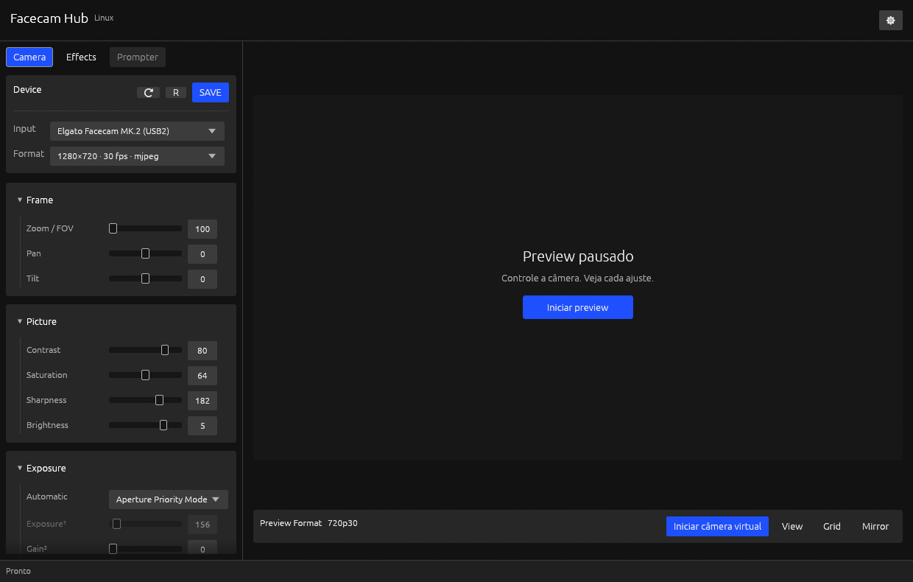
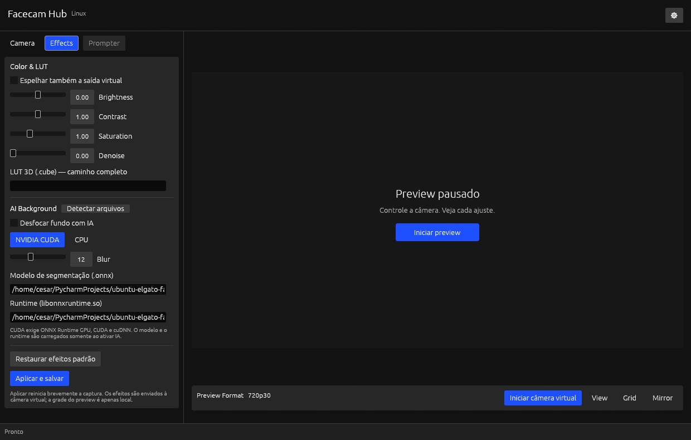

# Validação local — 25/10/2026

Ambiente observado: Ubuntu 24.04.5, X11, Facecam MK.2 USB2 e NVIDIA GeForce
RTX 4070 SUPER, driver 595.99.02. Estes resultados descrevem este host; não são
uma matriz de compatibilidade nem um benchmark controlado.

## Verificações concluídas

- Formatação e Clippy sem avisos, com recursos padrão e sem recursos padrão.
- 26 testes automáticos no build padrão: 22 testes unitários e 4 contratos CLI/IPC.
- 23 testes automáticos na compilação mínima, sem GUI, bandeja ou IA.
- Renderização FFmpeg sintética: espelho, brilho negativo/zero/positivo, redução
  de ruído, saturação zero e LUT, incluindo nomes de arquivo com espaços,
  apóstrofo, barra invertida, vírgula, dois-pontos, colchetes e ponto-e-vírgula.
- Mesma LUT entregue simultaneamente ao preview RGB e ao sink yuv420p sintético.
- Captura física sem efeitos e encerramento/reap do FFmpeg.
- Inferência ONNX real em CPU e em CUDA; processamento de frames completos e
  rejeição de frames truncados em ambos os providers.
- Preview físico com IA CUDA; verificação dos três filhos de vídeo antes da
  parada e ausência de seus PIDs após Stop. A inspeção inclui filhos de todas
  as threads do controlador.
- Preparador de IA em CPU, incluindo diretório com espaços, e configuração CUDA
  usando o cache local verificado. Downloads nativos CUDA tiveram SHA-256
  conferido; nenhum pacote global ou driver foi alterado.
- Revisão visual da aba Effects na janela nativa, com preview pausado. A
  screenshot em `screenshots/facecam-effects.png` não contém imagem da câmera.
- Links locais da documentação íntegros, sem a árvore documental copiada ou os
  arquivos da implementação anterior.

O teste de efeitos pela CLI aplica -0,25, zero e +0,25, confere o estado e o JSON
salvo e verifica que uma atualização inválida preserva ambos. A validação de
controles inclui extremos i64 e usa aritmética ampliada para evitar overflow.

## Amostra de execução

Com o release e IA CUDA, captura MJPEG 1280×720 a 30 fps, preview reduzido a
640×360 com limite de 15 fps:

| Observação | Resultado |
| --- | --- |
| Frames de preview adicionais | 76 |
| Intervalo observado | 5,13 segundos |
| Processos durante a captura | Controlador + decoder FFmpeg + worker Rust + FFmpeg de saída |
| Memória GPU reportada para o worker | 222 MiB |
| Filhos de vídeo remanescentes após Stop | 0 |

A contagem de preview não mede a taxa de uma câmera virtual consumida por outro
aplicativo. A janela de medição é curta e inclui o custo das consultas. Não houve
comparação controlada com outro software. Dados brutos e dependências utilizadas
ficam localmente em `target/ai-runtime/`, ignorado pelo Git; frames da câmera
foram mantidos somente em memória.

O binário GUI release medido na etapa de IA ocupava 17.747.632 bytes; o mínimo
headless, 1.850.784 bytes.
Isso não inclui FFmpeg, bibliotecas gráficas nem o runtime de IA. As bibliotecas
CUDA preparadas ocupam aproximadamente 2,4 GiB separadamente. Nada disso é
carregado na execução comum com IA desligada.

## Revisão de documentação e UI

Na revisão de 25/10/2026, versão declarada 3.0.0 em desenvolvimento, foram
registrados os [padrões de documentação e escrita](PADROES_DE_DOCUMENTACAO.md)
e alinhados os selects **Input** e **Format** do card **Device**.

O alinhamento foi conferido em janela 1240×790 com preview pausado e em janela
960×640 com captura ativa e selects desabilitados. A captura deste segundo
estado incluiu apenas o card, sem imagem da câmera. O build no perfil release,
o Clippy e a formatação passaram; os links locais também foram verificados.
O binário GUI recompilado ocupa 17.760.416 bytes. Esta revisão visual não
repete as medições de IA da etapa anterior.

## Revisão de cobertura e descoberta de IA

Na revisão seguinte de 25/10/2026, ainda na versão 3.0.0 em desenvolvimento, o
[manual](README.md) passou a mapear os 152 arquivos do acervo auditado, incluindo
137 Markdown, para seus destinos locais. A [matriz](COBERTURA_DOCUMENTAL.md)
registra assunto, adaptação e hash. Não há nomes ou textos copiados do produto
de origem na documentação mantida.

Foram aprovados 32 testes automáticos no build padrão e 29 no mínimo headless,
além da renderização sintética FFmpeg. Formatação, Clippy e sintaxe dos scripts
passaram. Dois testes documentais conferem links locais e a integridade das 152
entradas; isso não substitui revisão semântica.

O teste de processo iniciou sem `--config`, descobriu modelo/runtime em dados XDG
e em registro personalizado e não gravou `config.json`. Fixtures adicionais
verificam campos manuais, ausência, diretórios inválidos, preferência de pacote
CPU/CUDA e bibliotecas versionadas. A janela normal foi aberta com configuração
ausente e os dois campos apareceram preenchidos, sem ligar o desfoque.

Uma inferência CUDA real foi executada com caminhos omitidos, e uma inferência
CPU usou o registro produzido pelo preparador em diretório com espaços. O teste
de preview físico com IA também passou com ambos os caminhos vazios na configuração,
seguido de parada e reap de todos os filhos de vídeo. Esses testes não repetem a
bateria de qualidade visual ou a amostra de desempenho da etapa anterior.

O release GUI recompilado tem 17.817.328 bytes, SHA-256
`f313b9cdd48c8c8105a06272998a8b6449f602cce029a88cc4befe8fa06273eb`.
O mínimo headless tem 1.906.848 bytes. As dependências opcionais de IA continuam
fora desses tamanhos.

## Limites da validação

Não foi carregado um módulo de kernel para este teste. A saída yuv420p e sua
divisão com preview foram verificadas por um sink sintético, sem comprovar
consumo ponta a ponta por OBS, navegador ou videoconferência. Wayland está
habilitado na compilação, mas não foi exercitado em sessão real nesta etapa.
A CI Ubuntu 24.04 foi atualizada; sua execução remota não foi observada aqui.

A IA implementada desfoca o fundo. Não há troca por imagem, correção de olhar,
relighting, Prompter, atualização de firmware ou gravação interna na câmera.
A qualidade visual da segmentação não foi avaliada em uma bateria de pessoas,
iluminações e movimentos. Os testes confirmam execução, composição e ciclo de
vida; não garantem recorte perfeito em qualquer cena.
