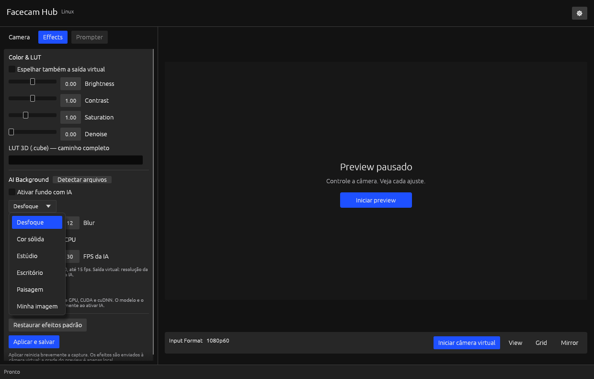
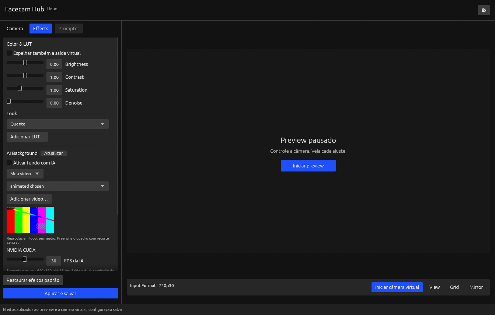
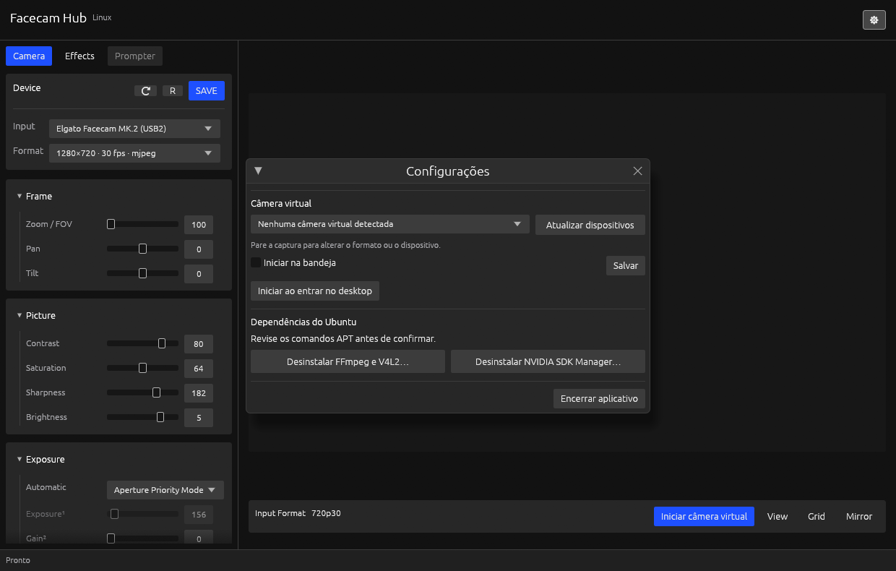

# Validação local — 25/10/2026

Ambiente observado: Ubuntu 24.04.5, X11, Facecam MK.2 USB2 e NVIDIA GeForce
RTX 4070 SUPER, driver 595.99.02. Estes resultados descrevem este host; não são
uma matriz de compatibilidade nem um benchmark controlado.

O registro acumula baterias de etapas diferentes. Os resultados atuais da
segmentação NVIDIA estão em [Segmentação temporal integrada](#segmentação-temporal-nvidia-integrada--25102026).

## Primeira bateria de verificações

- Formatação e Clippy sem avisos, com recursos padrão e sem recursos padrão.
- 26 testes automáticos no build padrão: 22 testes unitários e 4 contratos CLI/IPC.
- 23 testes automáticos na compilação mínima, sem GUI, bandeja ou IA.
- Renderização FFmpeg sintética: espelho, brilho negativo/zero/positivo, redução
  de ruído, saturação zero e LUT, incluindo nomes de arquivo com espaços,
  apóstrofo, barra invertida, vírgula, dois-pontos, colchetes e ponto-e-vírgula.
- Mesma LUT entregue simultaneamente ao preview RGB e ao sink yuv420p sintético.
- Captura física sem efeitos e encerramento/reap do FFmpeg.
- Inferência ONNX real em CPU e em CUDA; processamento de frames completos e
  rejeição de frames truncados em ambos os providers.
- Preview físico com IA CUDA; verificação dos três filhos de vídeo antes da
  parada e ausência de seus PIDs após Stop. A inspeção inclui filhos de todas
  as threads do controlador.
- Preparador de IA em CPU, incluindo diretório com espaços, e configuração CUDA
  usando o cache local verificado. Downloads nativos CUDA tiveram SHA-256
  conferido; nenhum pacote global ou driver foi alterado.
- Revisão visual da aba Effects na janela nativa, com preview pausado. A
  screenshot em `screenshots/facecam-effects.png` não contém imagem da câmera.
- Links locais da documentação íntegros, sem a árvore documental copiada ou os
  arquivos da implementação anterior.

O teste de efeitos pela CLI aplica -0,25, zero e +0,25, confere o estado e o JSON
salvo e verifica que uma atualização inválida preserva ambos. A validação de
controles inclui extremos i64 e usa aritmética ampliada para evitar overflow.

## Amostra de execução

Com o release e IA CUDA, captura MJPEG 1280×720 a 30 fps, preview reduzido a
640×360 com limite de 15 fps:

| Observação | Resultado |
| --- | --- |
| Frames de preview adicionais | 76 |
| Intervalo observado | 5,13 segundos |
| Processos durante a captura | Controlador + decoder FFmpeg + worker Rust + FFmpeg de saída |
| Memória GPU reportada para o worker | 222 MiB |
| Filhos de vídeo remanescentes após Stop | 0 |

A contagem de preview não mede a taxa de uma câmera virtual consumida por outro
aplicativo. A janela de medição é curta e inclui o custo das consultas. Não houve
comparação controlada com outro software. Dados brutos e dependências utilizadas
ficam localmente em `target/ai-runtime/`, ignorado pelo Git; frames da câmera
foram mantidos somente em memória.

O binário GUI release medido na etapa de IA ocupava 17.747.632 bytes; o mínimo
headless, 1.850.784 bytes.
Isso não inclui FFmpeg, bibliotecas gráficas nem o runtime de IA. As bibliotecas
CUDA preparadas ocupam aproximadamente 2,4 GiB separadamente. Nada disso é
carregado na execução comum com IA desligada.

## Revisão de documentação e UI

Na revisão de 25/10/2026, versão declarada 3.0.0 em desenvolvimento, foram
registrados os [padrões de documentação e escrita](PADROES_DE_DOCUMENTACAO.md)
e alinhados os selects **Input** e **Format** do card **Device**.

O alinhamento foi conferido em janela 1240×790 com preview pausado e em janela
960×640 com captura ativa e selects desabilitados. A captura deste segundo
estado incluiu apenas o card, sem imagem da câmera. O build no perfil release,
o Clippy e a formatação passaram; os links locais também foram verificados.
O binário GUI recompilado ocupa 17.760.416 bytes. Esta revisão visual não
repete as medições de IA da etapa anterior.

## Revisão de cobertura e descoberta de IA

Na revisão seguinte de 25/10/2026, ainda na versão 3.0.0 em desenvolvimento, o
[manual](README.md) passou a mapear os 152 arquivos do acervo auditado, incluindo
137 Markdown, para seus destinos locais. A [matriz](COBERTURA_DOCUMENTAL.md)
registra assunto, adaptação e hash. Não há nomes ou textos copiados do produto
de origem na documentação mantida.

Foram aprovados 32 testes automáticos no build padrão e 29 no mínimo headless,
além da renderização sintética FFmpeg. Formatação, Clippy e sintaxe dos scripts
passaram. Dois testes documentais conferem links locais e a integridade das 152
entradas; isso não substitui revisão semântica.

O teste de processo iniciou sem `--config`, descobriu modelo/runtime em dados XDG
e em registro personalizado e não gravou `config.json`. Fixtures adicionais
verificam campos manuais, ausência, diretórios inválidos, preferência de pacote
CPU/CUDA e bibliotecas versionadas. A janela normal foi aberta com configuração
ausente e os dois campos apareceram preenchidos, sem ligar o desfoque.

Uma inferência CUDA real foi executada com caminhos omitidos, e uma inferência
CPU usou o registro produzido pelo preparador em diretório com espaços. O teste
de preview físico com IA também passou com ambos os caminhos vazios na configuração,
seguido de parada e reap de todos os filhos de vídeo. Esses testes não repetem a
bateria de qualidade visual ou a amostra de desempenho da etapa anterior.

O release GUI recompilado tem 17.817.328 bytes, SHA-256
`f313b9cdd48c8c8105a06272998a8b6449f602cce029a88cc4befe8fa06273eb`.
O mínimo headless tem 1.906.848 bytes. As dependências opcionais de IA continuam
fora desses tamanhos.

## Validação funcional do commit `6a21d11`

Em 25/10/2026, o executável release desse commit foi aberto na sessão X11 real.
Os testes usaram diretórios XDG de configuração e execução separados dos dados
do usuário. Os controles V4L2 foram lidos antes das alterações e restaurados
depois. Frames da câmera permaneceram em memória; capturas da janela foram
feitas com o preview pausado.

| Fluxo exercitado | Resultado observado |
| --- | --- |
| Abertura e segunda execução | Janela disponível, câmera detectada e segunda execução apresenta a mesma instância |
| Descoberta de IA | Modelo e runtime preenchidos; limpar os campos e usar **Detectar arquivos** também funciona |
| Preview pela interface | **Iniciar preview** entrega frames e **View** pausa a captura |
| Formatos | Os 14 modos anunciados produziram frames, incluindo YUYV e MJPEG; o FPS consultado no driver coincide com o solicitado |
| Controles físicos | Brilho negativo/zero/positivo, contraste, saturação, sharpness, pan, tilt, zoom, anti-flicker, FPS dinâmico e privacy aceitos com leitura de retorno |
| Automático e manual | Exposição, ganho e balanço de branco exercitados; temperatura manual inativa é recusada no modo automático |
| Entrada inválida | Brilho fora do intervalo, pan fora do passo e opção ausente de menu recusados |
| Backlight | Firmware recusa a escrita com ERANGE; a recusa permanece no estado e o controle é excluído de **SAVE** |
| Presets | **SAVE** e **R**, acionados na janela, salvam e restauram o brilho lido do hardware |
| Efeitos pela interface | Espelho, brilho negativo e denoise aplicados, persistidos e usados pelo preview; restauração dos padrões conferida |
| LUT | Caminho digitado na janela, LUT `.cube` aplicada e textura com pixels de vídeo confirmada sem salvar frames |
| IA NVIDIA | Desfoque ativado pela janela, três filhos de vídeo presentes e worker visível no `nvidia-smi` com 222 MiB |
| Execução contínua de IA | MJPEG 1280×720 a 30 fps configurados, 205 frames adicionais de preview em 15 segundos e nenhum erro; parada encerra os três filhos |
| Troca para CPU | Provider alterado na janela com preview ativo; nova captura processada entrega frames |
| Falha de IA ou efeito | LUT ausente, brilho inválido, modelo ausente e runtime CPU com provider CUDA recusados, mantendo configuração e preview anteriores |
| Worker nativo | CPU e CUDA processam um frame completo e recusam entrada truncada nos testes optativos |
| Bandeja | Fechar a janela oculta a UI e encerra o preview; ativação D-Bus da bandeja reapresenta a janela |
| Interrupção de captura | Encerrar somente o FFmpeg pertencente ao teste produz erro visível e encerra os filhos de vídeo |
| Configurações e reabertura | **Salvar**, início minimizado e autostart exercitados em diretório isolado; JSON preservado após reabrir |
| Instalação | Instalar e remover com prefixo contendo espaço funciona, incluindo lançador e autostart isolados |
| Saída virtual ausente | Botão exibe a instrução de v4l2loopback e preserva o preview que já estava ativo |

Os checks automáticos passaram novamente: formatação, Clippy, 32 testes no build
padrão, 29 no mínimo, renderização sintética FFmpeg e sintaxe dos scripts.
Os logs desta sessão ficam em `target/functional-review/` e
`target/functional-checks.log`, ignorados pelo Git.

A passagem por cada modo foi curta e confirma abertura e entrega de frames;
consultar FPS no driver não mede a taxa sustentada de entrega. Grid e Mirror
local foram acionados sem alterar o efeito de espelho persistido, mas não houve
comparação visual automatizada dessas sobreposições. Nenhum destes resultados
constitui uma garantia para outros dispositivos ou condições de iluminação.

## Revisão de desempenho e fundos de IA

Em 25/10/2026, após o relato de lentidão em 1080p60, o binário anterior foi
comparado ao release com composição reutilizável, redução antes do worker no
preview e taxa de processamento explícita. Ambos usaram o mesmo modelo, runtime
CUDA, driver e RTX 4070 SUPER. Não houve alteração de driver ou instalação global.

No benchmark sintético do worker completo, cada execução recebeu 80 frames RGB
1920×1080 e os primeiros cinco ficaram fora da janela de taxa estável. Foram
feitas três execuções de cada binário, alternando a ordem. A mediana passou de
**14,37 para 47,83 fps**, aproximadamente 3,3 vezes. Esse teste inclui inferência,
composição e pipes, sem decodificação de câmera, GUI ou consumidor virtual.
A composição nova é comparada ao caminho escalar anterior em teste de pixels,
com tolerância máxima de um nível u8 por canal; os extremos de alpha mantêm
primeiro plano e substituição opaca.

Em uma amostra separada da câmera física MJPEG 1920×1080 a 60 fps, somente preview:

| Observação | Anterior | Revisão |
| --- | --- | --- |
| RGB recebido pelo worker | 1920×1080 | 640×360 |
| Frames adicionais de preview em aproximadamente 5,1 s | 18 | 77 |
| CPU do controlador e três filhos, com 100% = um núcleo | 113,2% | 46,8% |
| Início do pedido até pelo menos cinco frames | 2.793 ms | 992 ms |
| Filhos de vídeo após Stop | 0 | 0 |

A implementação anterior mantinha timestamps rawvideo da entrada a 60 fps
mesmo quando o worker processava mais devagar; o filtro de preview descartava
frames dessa sequência. A nova entrada do segundo FFmpeg declara a taxa
efetivamente escolhida para processamento. O preview já chega ao worker em
640×360 e até 15 fps; com saída virtual, `ai_fps` limita a taxa e mantém a resolução.
As amostras são curtas e não medem latência ponta a ponta ou taxa entregue ao OBS.

Foram exercitados na captura real desfoque, cor sólida, estúdio, escritório,
paisagem e PNG próprio. Seleção de estúdio e cor, aplicação e edição do caminho
da imagem foram acionadas na janela. Um PNG corrompido foi recusado no aquecimento,
preservando a configuração e o preview anteriores. Cenários são ilustrações
próprias geradas por código, não fotos ou recursos de terceiros. Testes também
verificam JPEG, WebP, transparência opaca e rejeição de dimensões excessivas.

Os arquivos de medição ficam em `target/functional-review/ai-comparison.json`,
`live-before.json` e `live-after.json`, ignorados pelo Git. Os checks aprovados
somam 36 testes no build padrão e 30 no mínimo, além da renderização FFmpeg,
Clippy, formatação e sintaxe dos scripts. A comparação não certifica o SDK
Maxine: esta revisão continua usando ONNX Runtime/CUDA.

## Fundos animados e instalação APT — 25/10/2026

O alvo de aceitação passou a ser Camera Hub Windows 2.3.0.7295, incluindo layout
e recursos de IA na RTX 4070 SUPER, conforme funcionamento relatado pelo usuário
no Windows. Não houve execução do aplicativo Windows no Ubuntu nem comparação
pareada de qualidade ou desempenho com essa plataforma.

Os checks padrão passaram: 40 testes no build completo e 33 no headless,
formatação, Clippy e sintaxe dos scripts. Duas renderizações optativas FFmpeg
passaram, incluindo fundo animado com loop, adaptação de taxa, caminho com
caracteres especiais e recusa de mídia inválida. Testes nativos em CPU e CUDA
confirmaram composição e encerramento do decoder em duas situações: EOF normal
e morte forçada do worker. Um leitor externo manteve o pipe aberto no segundo
caso, permitindo verificar o sinal de morte do pai sem depender de broken pipe.

Na Facecam, um preview CUDA com fundo MP4 próprio, entrada MJPEG 1280×720 a
30 fps e processamento de preview a 640×360/15 fps produziu 32 frames em 2.740 ms,
incluindo início da captura. Foram observados três filhos de vídeo do controlador
e um decoder de fundo pertencente ao worker. Após Stop, nenhum desses processos
continuou em execução. A amostra confirma entrega, não uma medição sustentada de
FPS ou latência ponta a ponta. Nenhum controle da câmera foi escrito nesta etapa.

Na janela X11, foram exercitados o seletor nativo do portal KDE, a seleção de um
MP4 com espaço no nome, aplicação e salvamento pelo controlador. O painel mantém
controles à esquerda e preview à direita; a revisão não certifica igualdade de
todos os pixels e estados com o Windows. CPU é apresentada nas opções avançadas
como alternativa ONNX, sem ser confundida com um fallback dos SDKs NVIDIA.

O fluxo APT foi aberto pela UI e cancelado na revisão do plano. O cancelamento
não iniciou comandos, não criou log de instalação e não cadastrou repositório.
Os testes de IPC também verificaram confirmação ausente, plano substituído,
ID cancelado e configuração preservada. Um teste optativo do APT verificou a
assinatura NVIDIA e encontrou `sdkmanager 26.1.0-14392` usando configuração,
listas, cache e logs temporários; fontes do sistema permaneceram intactas.
A chave pública tem o hash registrado em [Dependências](DEPENDENCIAS_E_LICENCAS.md).

A autenticação administrativa real e uma instalação de pacotes não foram
executadas nesta revisão. Os resultados ficam em `target/windows-parity-review/`
e o log dos checks em `target/functional-review/windows-parity-checks.log`,
ignorados pelo Git. A integração Maxine VFX/AR Linux continua pendente de seus
runtimes/modelos e validação própria; SDK Manager não fornece essa paridade.

## Biblioteca automática de recursos — 25/10/2026

A GUI passou a mostrar Looks e fundos pelo nome, com miniatura do fundo, sem
campos de caminho para LUT, imagem, vídeo, modelo/runtime ou dispositivo virtual.
Os três Looks próprios foram gerados e validados; não contêm recursos extraídos
do Camera Hub. Na janela X11, **Adicionar LUT…** abriu o portal KDE, importou uma
LUT sintética, selecionou seu nome e só persistiu o efeito após **Aplicar e salvar**.
O Look **Quente** também foi materializado e aplicado pela UI. Salvar configurações
preservou Quente confirmado e Frio em rascunho, sem aplicação implícita. O rodapé continuou
acessível com rolagem, opções avançadas abertas e janela de 1000×680 pixels. A saída virtual foi apresentada
como não detectada, coerente com a ausência do módulo neste teste.

Passaram 43 testes comuns no build completo e 36 no headless, além de três testes
optativos FFmpeg, formatação, Clippy e sintaxe dos scripts. A biblioteca foi
exercitada com PNG, JPEG, WebP, BMP, MP4, MOV, WebM e MKV sintéticos, caminhos com
espaço e caracteres especiais, origem removida, nomes repetidos, reinício e
conteúdo inválido. LUTs incluíram valores negativos, zero, positivos e não finitos.
Importar não aplicou efeitos nem escreveu configuração; falhas não publicaram
arquivos parciais. Logs: `target/windows-parity-review/library-checks-final.log`.

Um preview real com CUDA, Look Quente e fundo animado produziu 32 frames em
2.754 ms, incluindo partida, com entrada 1280×720/30 fps e preview 640×360/15 fps.
Stop recolheu os três filhos de vídeo e o decoder do worker, sem controles
V4L2 escritos. É confirmação de funcionamento local, sem benchmark sustentado
ou comparação de qualidade com Windows. Resultado: `live-library-result.json`
no mesmo diretório ignorado. A integração dos SDKs Maxine continua pendente.

## Estado das dependências e Configurações — 25/10/2026

O teste APT executado pelo usuário terminou sem erro. O log
`~/.config/elgato-virtualcam/install-1792952383366.log` informa que FFmpeg
`7:6.1.1-3ubuntu5` e v4l-utils `1.26.1-4build3` já eram as versões mais recentes,
com zero pacotes novos instalados. A consulta independente ao dpkg confirmou
ambos instalados. O SDK Manager estava ausente.

O app passou a derivar as ações desse estado, incluindo pacotes que já existiam
antes de sua execução. Na janela X11 de 1240×790 pixels, Configurações ficou
centralizada nos dois eixos, inclusive após reduzir a janela para 1000×680,
com largura de 560 pontos lógicos e dois botões
iguais na mesma linha. FFmpeg/V4L2 exibiu **Desinstalar…**, e SDK Manager exibiu
**Instalar…**. A abertura de **Desinstalar…** simulou somente os dois pacotes
solicitados e mostrou a confirmação própria. Cancelar descartou o plano sem
iniciar processo administrativo ou criar log de remoção. Não houve remoção real.

A revisão visual seguinte acrescentou separador e título ao bloco **Câmera virtual**,
alinhou seletor e **Atualizar dispositivos** na mesma linha e posicionou **Salvar**
e **Encerrar aplicativo** à direita, mantendo o rodapé compacto. O layout foi
inspecionado em 1240×790 e 1000×680 pixels. Na captura atual, SDK Manager
`26.1.0-14392` também já estava instalado, confirmado pelo dpkg, e ambos os botões
exibiram **Desinstalar…**. Isso não comprova instalação dos runtimes Maxine VFX/AR.

Passaram 47 testes comuns no build completo, 40 no headless e três verificações
FFmpeg, além de Clippy, formatação e sintaxe dos scripts. As regressões incluem
estado dpkg parcial/incompleto, rejeição de remoções adicionais, conferência do
estado final e atualização automática a partir de um banco dpkg temporário,
sem alterar pacotes do sistema. Evidências ficam em `target/apt-state-review/`
e `target/apt-state-checks.log`, ignorados pelo Git.

## Cards da aba Effects — 25/10/2026

**Effects** passou a usar cards no mesmo padrão de **Camera**: Look, Picture,
Processing e AI Background, com provider em Opções avançadas inicialmente
recolhido. Foram conferidos espaçamento, alinhamento de rótulos/sliders/valores,
recolhimento, rolagem e acesso ao rodapé de aplicação na janela X11, em
1240×790 e 1000×680 pixels. Recolher Picture em Effects não recolheu Picture
na aba Camera; os estados foram conferidos ao alternar entre as abas.

Um Brightness de -0,25 foi editado pelo campo numérico. O snapshot confirmado
permaneceu em zero até Aplicar e salvar; depois, estado e JSON refletiram -0,25.
Um vídeo sintético com nome longo entrou na biblioteca, apareceu abreviado no
seletor de largura estável e teve miniatura exibida. Restaurar efeitos padrão e
aplicar retornou Brightness a zero e o modo de fundo a desfoque. Nenhuma captura foi iniciada
nem controle V4L2 escrito. Evidências ficam em `target/effects-ui-review/`.

O build release foi atualizado e `./test-desktop-app.sh` passou com 47 testes no
build completo, 40 no headless, três verificações FFmpeg, formatação, Clippy e
sintaxe dos scripts. A alteração de layout mantém os mesmos comandos do controlador.

## Limites da validação

Não foi carregado um módulo de kernel para este teste. A saída yuv420p e sua
divisão com preview foram verificadas por um sink sintético, sem comprovar
consumo ponta a ponta por OBS, navegador ou videoconferência. Wayland está
habilitado na compilação, mas não foi exercitado em sessão real nesta etapa.
A CI Ubuntu 24.04 foi atualizada; sua execução remota não foi observada aqui.

A IA implementada desfoca ou substitui o fundo por cor, cenário ilustrado ou
imagem ou vídeo próprio. Não há correção de olhar, relighting, Prompter, atualização de
firmware ou gravação interna na câmera.
A qualidade visual da segmentação não foi avaliada em uma bateria de pessoas,
iluminações e movimentos. Os testes confirmam execução, composição e ciclo de
vida; não garantem recorte perfeito em qualquer cena.

## Preparação e consumo da câmera virtual — 25/10/2026

Árvore em desenvolvimento após `2091dc1`, Ubuntu 24.04.5, kernel
`7.0.0-38-generic`, sessão X11 e Facecam MK.2 em USB2. O módulo v4l2loopback
0.15.3 já estava no pacote nativo do kernel, assinado pela Canonical, com Secure
Boot ativo. Não foi necessário instalar DKMS ou alterar o driver NVIDIA.

O usuário confirmou o plano na GUI e autenticou a preparação. O fluxo inicial
solicitou quatro autenticações, uma por comando. Os quatro passos terminaram
sem erro: modprobe, dois arquivos de configuração e update-initramfs.
`/dev/video10` apareceu como **VirtualCam**, driver `v4l2 loopback`, e os arquivos
`/etc/modprobe.d/facecam-hub.conf` e `/etc/modules-load.d/facecam-hub.conf` foram
conferidos. Não houve reinicialização para testar a persistência.

A revisão seguinte substitui as quatro chamadas pkexec por uma única chamada
ao helper restrito do próprio binário. Os testes conferem um único comando de
autorização, igualdade entre payload e etapas revisadas e recusa de entradas
inválidas. A execução privilegiada desse novo helper ainda não foi repetida:
o módulo já estava carregado, e o app não o descarrega para refazer a preparação.

O Chrome 156.0.8078.47 consumiu a câmera virtual real por WebRTC, em perfil
temporário e sem dispositivo de câmera sintético. O produtor usou a Facecam em
MJPEG 1280×720/30 e enviou yuv420p. O preview permaneceu desligado.

| Rodada | Saturação | Vídeo informado pelo consumidor | Frames apresentados | Janela de medição |
| --- | --- | --- | --- | --- |
| 1 | 0 | 1280×720, 30 fps, sem redimensionamento | 45 | 1.535 ms |
| 2, após parar e reiniciar | 1 | 1280×720, 30 fps, sem redimensionamento | 45 | 1.503 ms |

Uma amostra em memória de 64×36 confirmou a alteração de cor: a maior diferença
entre canais RGB foi 3 com saturação zero e 185 com saturação um. A parada final
deixou `streaming` e `preview` falsos, sem erro. São amostras curtas de aceitação,
não um ensaio de estabilidade ou garantia sustentada de taxa.

O teste optativo Rust `hardware_virtual_camera_delivers_effects_and_restarts`
também passou: um consumidor FFmpeg recebeu 30 frames em cada uma de duas rodadas
com parada e retomada. Conferiu crominância neutra a até 1 de 128 com saturação
zero. Pixels ficaram apenas em memória; não foram salvas imagens, gravações ou
capturas de tela da pessoa. Nenhum controle físico foi escrito.

`./test-desktop-app.sh` passou com 50 testes comuns no build completo, 43 no
headless, três checks FFmpeg sintéticos, formatação, Clippy e sintaxe dos scripts.
Os checks comuns continuam sem captura física; o teste de falha de startup
agora isola a ferramenta V4L2 para não selecionar um loopback presente no host.
O teste físico permanece ignorado por padrão. Logs e métricas locais estão em
`target/virtual-camera-review/`, ignorado pelo Git.

OBS, sessão Wayland, operação prolongada e persistência após reiniciar continuam
pendentes. A referência de integração NVIDIA passou a ser os redistribuíveis
Video Effects 0.7.6 e AR 0.8.2 para RTX 40/Ada associados ao Camera Hub no
[guia dos runtimes NVIDIA](NVIDIA_MAXINE.md). Não foi implementado ou anunciado
um backend VFX/AR nativo nesta revisão.

## Checkbox de início automático — 25/10/2026

**Iniciar ao entrar no desktop** passou a ser um checkbox com aplicação imediata
pelo controlador. Na janela X11 de 1240×790, marcar criou a entrada desktop em
um `XDG_CONFIG_HOME` isolado, e desmarcar removeu o arquivo e publicou false no
snapshot. **Iniciar na bandeja** permanece uma preferência confirmada por **Salvar**.
As capturas `enabled.png` e `disabled.png` em `target/autostart-ui-check/` mostram
preview pausado. O cadastro real do usuário não foi alterado pelo teste visual.

O contrato automatizado confirmou persistência ao reabrir, desativação idempotente,
atualização após desabilitação externa e falha de filesystem sem marcar sucesso
ou gravar a configuração da câmera. O script completo passou com 51 testes no
build padrão e 44 no headless, além de três checks FFmpeg, formatação e Clippy.
O caso de autostart atualizado também passou isoladamente nas duas compilações.
O build release foi atualizado; não houve novo login no desktop nesta validação.

## Configurações com aplicação imediata — 25/10/2026

O botão **Salvar** foi removido de Configurações. `UpdateSettings` persiste os
campos alterados antes de publicar o novo estado, preservando efeitos e controles.
**Iniciar na bandeja** pode ser alterado durante captura; a seleção da câmera
virtual continua disponível apenas com captura parada.

Na janela X11 de 1343×856, o checkbox foi marcado e desmarcado, sem botão de
confirmação. O JSON isolado e o snapshot acompanharam true e false imediatamente.
A janela permaneceu aberta com preview pausado. A imagem `settings.png` e os
resultados em `target/settings-live-ui-check/` registram essa inspeção; não houve
alteração do autostart real do usuário ou de controles da câmera.

O teste de núcleo confirmou preservação de efeitos/campos adicionais e manutenção
do estado em valor inválido ou erro de filesystem. O script completo passou com
52 testes comuns no build padrão e 45 no headless, três checks FFmpeg sintéticos,
formatação, Clippy e sintaxe dos scripts. O release foi atualizado.

## Ajuda contextual em Configurações — 25/10/2026

O aviso permanente sobre revisar comandos APT foi removido de Configurações.
A orientação para parar a captura foi movida para o pequeno **(?)** ao lado de
**Câmera virtual**. Na janela X11 de 1343×856, a mensagem apareceu ao passar o
mouse sobre o indicador; a linha de orientação deixou de ocupar espaço no bloco.
O preview permaneceu pausado, sem operações administrativas.

As imagens `settings.png` e `help.png` em `target/settings-help-ui-check/` registram
a inspeção do layout e do tooltip. Formatação, Clippy, links e inventário
documental passaram. A alteração afeta apenas apresentação; o build release
foi atualizado, sem repetir testes de hardware.

O indicador textual foi substituído por um ícone vetorial circular com **?**
centralizado, desenhado pelo egui. A revisão visual em 1343×856 confirmou o ícone
e a ajuda ao passar o mouse, com preview pausado. As imagens ficam em
`target/settings-help-icon-ui-check/`. Formatação, Clippy, documentação e build
release passaram nesta alteração de apresentação.

## Redistribuíveis NVIDIA de referência — 25/10/2026

A origem foi corrigida para o [NVIDIA Broadcast Download Center](https://www.nvidia.com/en-us/geforce/broadcasting/broadcast-sdk/resources/),
acessado pelo link do [guia Elgato](https://help.elgato.com/hc/en-us/articles/7665140128653-Elgato-Camera-Hub-How-to-use-AI-Background-Effects).
Os pacotes selecionados são Video Effects 0.7.6 e AR 0.8.2 para RTX 40/Ada.
A página associa Camera Hub a essas versões; a versão carregada por uma instalação
específica ainda precisa ser conferida. A documentação de uso, efeitos, roadmap
e investigação passou a seguir esses redistribuíveis como referência.

Os dois downloads HTTPS retornaram HTTP 200. Os tamanhos locais coincidiram com
o Content-Length informado pelo servidor, e os arquivos foram identificados
como executáveis PE32 com arquivo autoextraível NSIS. Isso identifica o contêiner
do instalador; não determina a arquitetura de cada DLL interna.

| Arquivo em `/home/cesar/Downloads/NVIDEA/` | Bytes | SHA-256 local |
| --- | --- | --- |
| `nvidia_video_effects_sdk_installer_v0.7.6_ada.exe` | 767.555.072 | `4761fe1579e82de6d45efec8dc09492cf2cc601867269955e129707ac8ea8546` |
| `nvidia_ar_sdk_installer_v0.8.2_ada.exe` | 1.167.071.912 | `cf1eb45839d4b0131bbc08c7205bb9ccc2989e6d91ec2da28e8ee0e515da28e1` |

`SHA256SUMS` e `download-manifest.json` no mesmo diretório registram os hashes e
a procedência. Os digests foram calculados localmente, sem um hash independente
publicado pelo fornecedor para comparação. `7z l` reconheceu o conteúdo dos dois
instaladores, incluindo DLLs NVIDIA; os `.exe` não foram executados ou instalados.
Os cabeçalhos HTTP, métricas de transferência e listagens ficam em
`target/nvidia-redistributables/`, ignorado pelo Git. Essa inspeção não equivale
a análise REA/Ghidra completa nem à execução dos efeitos no Ubuntu.

A listagem VFX contém `NVVideoEffects.dll`, dependências CUDA 12 e modelos
`AIGS_288x512_89_m*.engine.trtpkg`. A listagem AR contém `nvARPose.dll`,
`cudart64_110.dll`, TensorRT e modelos `gazeredir_*_fp16_89.engine.trtpkg`.
Esses arquivos não foram tratados como modelos ONNX do worker atual.

## Remoção dos artefatos macOS do `.pkg` — 25/10/2026

Foram removidos `CameraHub_2.3.0.7295.pkg`, os diretórios
`camerahub-2.3.0.7295-xar` e `camerahub-2.3.0.7295-payload`, e os relatórios
exclusivos de macOS: dependências Mach-O, strings nativas, inventário do payload,
inspeção REA e hashes do pacote/aplicativo. Também foi removido
`analysis-windows-2.3.0.7295/mac-ai-strings.txt`.

O MSI, sua extração e investigação Windows, medições Rust, auditoria documental
e ferramentas compartilhadas foram mantidos. Em `analysis-2.3.0.7295`, continuam
as leituras de USB/V4L2 e o diagnóstico genérico da ferramenta REA. Os relatórios
mistos da investigação Windows continuam como registro histórico.
O inventário da limpeza está em `target/nvidia-redistributables/macos-pkg-cleanup.json`.
O documento de levantamento inicial foi identificado como histórico para não
apresentar os caminhos removidos como arquivos disponíveis.

## Análise estática RTX e organização por versão — 25/10/2026

Foram extraídas duas amostras de modelos, as DLLs principais, dependências
selecionadas e licenças dos pacotes Ada já baixados. Os arquivos ficam em
`package/nvidia-reference/windows-x86_64/{vfx/0.7.6,ar/0.8.2}/ada/`.
As evidências foram preservadas em `package/analysis-nvidia/`, separado por
plataforma, SDK, versão e família, fora da distribuição e do Git.

REA 6.7.0, executado pelo Node.js 24.22.1 local, analisou as importações PE:

| DLL | SHA-256 | Cobertura da tabela de importações |
| --- | --- | --- |
| `NVVideoEffects.dll` | `2a78effae55e9e3791bbe66f312f0bd08a2ede2c94fd8f820933badfa0a6cd8c` | 22 DLLs, 245 funções, sem delay imports |
| `nvARPose.dll` | `659f4c30f1d7c5a459e25b9f62fe0d49282079872260c8f7ec16b0f4b3101010` | 24 DLLs, 311 funções, sem delay imports |

Os IDs das evidências são, respectivamente,
`ev_057e4b6313e8d4df43b19a3572ca7d38fb4a79f9bf57606e2bb87f1463da5395`
e `ev_9f4af8c7de9d2ccc74ff398694eb7c55e8b5642f37ba2723af60a31f788e6fdf`.
A cobertura completa se refere às tabelas examinadas, sem abranger todas as
bibliotecas carregadas dinamicamente ou o comportamento do efeito.

Ghidra 12.1.4 com OpenJDK 21.0.12.1 decompilou `GetVersion`, criação e `Load`
de cada SDK, além de quatro auxiliares chamados pela criação. Foram usados
`-noanalysis`, `-max-cpu 2` e `-deleteProject`; as fontes Java e logs ficaram
preservados. Os logs registraram dez funções concluídas. Os resultados contêm
tipos não recuperados, chamadas indiretas e avisos; não são código reconstruído
pronto para compilação.

O export `NvVFX_GetVersion` escreve `0x00070600` no endereço `0x180009930`;
`NvAR_GetVersion` escreve `0x00080200` em `0x180005a60`. A desmontagem estática
de `getInferLibVersion` mostrou 100400 em `0x180681b60` no TensorRT VFX e 8402
em `0x180ac2f50` no TensorRT AR. As fórmulas oficiais permitem derivar 10.4.0
e 8.4.2; nenhuma dessas funções foi executada.

As amostras `AIGS_288x512_89_m1.engine.trtpkg` (8.773.968 bytes) e
`gaze_landmarks_fp16_89.engine.trtpkg` (3.561.076 bytes) começam por `NVnn`.
Seus hashes e os dos runtimes estão no [catálogo documental](nvidia-runtime-catalog.json).
Não foi recuperado um modelo ONNX ou engine Linux utilizável. As licenças dos
instaladores foram extraídas para leitura local; os fontes públicos dos proxies
foram consultados em revisões fixadas, preservando seus avisos originais.

`nvidia-smi --query-gpu=name,pci.device_id,driver_version,compute_cap --format=csv,noheader`
confirmou RTX 4070 SUPER, ID `0x278310DE`, driver 595.99.02 e compute capability
8.9. A consulta `ldconfig -p` não listou `libnvinfer`, `libcudart` ou
`libonnxruntime`; esse resultado abrange apenas o cache do carregador, sem
excluir bibliotecas em diretórios privados. Não houve instalação APT, execução
dos SDKs Windows, captura de imagem ou alteração de controles da câmera.

[Análise RTX](ANALISE_RTX.md) registra a viabilidade ainda não demonstrada do
backend nativo, os contratos recuperados e os critérios da
próxima prova. Os efeitos existentes e a configuração do aplicativo não foram
alterados por essa investigação.

Validação desta etapa: `cargo test --locked --test documentation` passou nos dois
testes de links e cobertura, e `git diff --check` passou. A conferência local do
catálogo comparou seis hashes/tamanhos com os arquivos extraídos, a arquitetura
PE x64, os dois relatórios REA e as dez conclusões dos scripts Ghidra. O resultado
ficou em `target/nvidia-redistributables/catalog-validation.json`. Os diretórios
de binários e análise foram confirmados como ignorados pelo Git.

## Pesquisa focada na segmentação Rust — 25/10/2026

A direção passou a usar somente as referências Windows e implementação própria
em Rust. A pesquisa deve fechar o contrato necessário a segmentação, desfoque e
substituição de fundo no worker existente; a reconstrução completa dos SDKs e a
obtenção de SDKs NVIDIA Linux não são pré-requisitos.

Foram examinadas mais quinze funções selecionadas com Ghidra, sem análise global
ou execução dos binários. O caminho VFX identifica a criação de `GreenScreen`,
as funções reais de `Load` e `Run`, a seleção do modelo e a inicialização dos
tensores. A tabela de modelos contém quatro entradas Ada `m0` a `m3`, com
valores `[288, 512, 89, 89]`. Os layouts e tipos dos tensores não foram inferidos
somente desses valores.

A leitura limitada dos metadados dos dois modelos confirmou registros `trt`
de 136 e 76 bytes no offset 28. A tabela `dpvi` contém cinco campos e quatro
linhas no VFX, uma no AR. Essa leitura não decodifica os pesos nem executa a rede.

O inventário REA de código GPU foi concluído antes de restringir o escopo ao
recurso de fundo. Encontrou declarações de CUBIN/PTX e permitiu inspecionar
metadados selecionados `sm_89` no VFX e `sm_86` no AR. Esses resultados são
estáticos: não demonstram inferência nem suporte de todas as funções da DLL.
Nenhum kernel proprietário foi integrado ao produto.

As evidências estão em `package/analysis-nvidia/segmentation-reconstruction/`:
`scope.json` associa as quinze funções a endereços, papéis e hashes;
`greenscreen-model-table.json` conserva as entradas lidas; `model-metadata.json`
conserva os metadados. O nome exploratório `segmentation-select` foi preservado
como arquivo de evidência, mas seu papel foi corrigido no inventário para reset.
O documento [Análise RTX](ANALISE_RTX.md#escopo-necessário-à-implementação) define
as perguntas restantes e o critério para passar da pesquisa à implementação.

## Segmentação temporal NVIDIA integrada — 25/10/2026

Esta etapa substitui o estado de pesquisa pendente dos registros anteriores:
o worker Rust executou o modelo m1 do Video Effects 0.7.6 Ada com TensorRT
10.4.0.26 e ONNX Runtime GPU 1.20.1. Ambiente: o mesmo Ubuntu 24.04.5, RTX 4070
SUPER compute capability 8.9 e driver 595.99.02, árvore de desenvolvimento após
`7b1c55e`, sem nova versão publicada. AR e paridade completa com Windows não
foram demonstrados.

A recuperação local conferiu DLL e contêiner por SHA-256, leu AES-256-CBC e
produziu o engine de 8.773.772 bytes. TensorRT recusou primeiro a plataforma
Windows; a adaptação dos quatro bytes de marcador descrita em
[Análise RTX](ANALISE_RTX.md) permitiu carregar esse engine exato. A inspeção nativa
confirmou os 14 tensores, incluindo seis pares de estados. Uma prova Rust usando
apenas APIs seguras executou a mesma rede antes da integração ao worker.

A preparação pelo comando público `--prepare-nvidia`, com controlador headless
e configuração temporária, reutilizou os downloads locais conferidos. Extraiu
os componentes no usuário, criou EPContext próprio e testou uma inferência real
antes da publicação. O destino normal do usuário ficou disponível para descoberta
sem argumentos extras; a configuração pessoal não foi modificada. Nenhum pacote
do sistema, driver, fonte APT ou senha foi alterado. O diretório preparado ocupa
cerca de 3,4 GiB; parte de CUDA foi reutilizada por hardlinks, sem duplicar esses
blocos físicos. Cache de downloads e binário são medidas separadas.

A primeira execução em debug chegou à inferência, mas uma recompilação durante
o preparo havia substituído seu executável: o teste final falhou e os arquivos
parciais não foram publicados. A correção usa `/proc/PID/exe` para testar a própria
versão em execução. A repetição em release concluiu. Esse caso também verificou
a preservação do destino ativo após falha de preparação.

### Saída, recursos e seleção de backend

O teste optativo `nvidia_worker_composes_backgrounds_resets_state_and_rejects_partial_frames`
passou na GPU: oito quadros pretos por rodada, composição opaca exata, três
cenários distintos, desfoque preto, reinício determinístico e recusa de quadro
truncado sem publicar saída parcial. Testes comuns conferem manifesto incompleto,
versão desconhecida, tamanho excessivo, contêiner truncado, probabilidades
negativas/zero/positivas/não finitas e interpolação retangular contra referência
escalar. O teste de ferramentas ausentes usa GPU simulada, oferece somente o
plano APT e cancela sem downloads ou instalação.

Uma [imagem pública de teste](https://storage.googleapis.com/mediapipe-assets/portrait.jpg)
foi mantida apenas em `target/`, fora do Git. Vinte quadros por modo verificaram
cor sólida, imagem azul e vídeo sintético: o fundo mudou e a pessoa permaneceu
visível, incluindo rosto, braços e roupa. Os resultados foram inspecionados.
Isso é uma amostra visual, sem métricas de precisão de borda, cabelo ou movimento.

Sete verificações independentes de `--check-ai` confirmaram:

| Caso | Resultado |
| --- | --- |
| `auto` + componentes preparados + CUDA | NVIDIA, inferência real |
| Componentes ausentes + fallback disponível | ONNX/CUDA |
| Componente NVIDIA inválido + fallback disponível | ONNX/CUDA, aviso com motivo |
| NVIDIA explícita + componente inválido | Erro, sem troca de backend |
| CUDA explícita + runtime ONNX somente CPU | Erro, sem fallback CPU |
| CPU explícita + componentes NVIDIA presentes | ONNX/CPU |
| NVIDIA explícita + CPU | Configuração recusada |

### Amostra de desempenho do worker release

Medição sem captura: 120 repetições de uma imagem RGB, pipes de entrada/saída,
redimensionamento, inferência, máscara e composição incluídos. A taxa abaixo usa
os 110 quadros após os dez primeiros; o tempo até o primeiro inclui carregamento
e aquecimento. Não havia outro teste NVIDIA simultâneo. O consumidor reutilizou
um buffer de quadro, evitando cópias cumulativas que distorceram uma medição
exploratória anterior. Não houve limitador de tempo real nessa prova.

| Backend | Saída | Fundo | Taxa observada | Primeiro quadro | Pico RSS amostrado |
| --- | --- | --- | --- | --- | --- |
| NVIDIA temporal | 640×360 | Cor sólida | 105,2 fps | 447 ms | 689 MiB |
| NVIDIA temporal | 640×360 | Desfoque | 71,1 fps | 402 ms | 694 MiB |
| NVIDIA temporal | 1280×720 | Cor sólida | 68,5 fps | 403 ms | 695 MiB |
| NVIDIA temporal | 1280×720 | Desfoque | 49,1 fps | 412 ms | 693 MiB |
| ONNX/CUDA anterior | 640×360 | Desfoque | 104,1 fps | 532 ms | 832 MiB |

As redes têm contratos e qualidade distintos; essa tabela não demonstra que
NVIDIA seja mais rápida que ONNX em todos os cenários. RSS inclui bibliotecas
nativas e não representa somente memória do modelo ou memória GPU. O probe
inicial mediu 20 inferências sintéticas da rede em 18,95 ms, sem a aplicação;
a taxa de aproximadamente 1.055 inferências/s desse probe não é FPS do produto.

### Câmera virtual e interface

Com captura física MJPEG 1280×720/30, desfoque NVIDIA, preview e saída virtual
ativos, um consumidor FFmpeg recebeu 90 quadros yuv420p de `/dev/video10` em
2,94 s. O snapshot publicou backend `nvidia`, sem fallback. Stop encerrou a
captura e o reinício de preview produziu mais de três quadros (22 na consulta).
Nenhuma imagem da câmera foi salva nem controle V4L2 escrito. O consumidor
registrou avisos de DTS repetidos ao remapear os timestamps para sua base 1/30;
a prova verifica entrega e retomada, não precisão temporal ou uma sessão longa.
OBS, WebRTC com este novo backend e comparação com Windows não foram repetidos.

A janela X11 real foi aberta com configuração privada e preview pausado. O bloco
**Efeitos NVIDIA RTX** coube no painel centralizado de configurações, preservou
os dois botões APT na mesma linha e **Encerrar aplicativo** à direita.
A [captura da janela](screenshots/facecam-rtx-settings.png) não contém vídeo da câmera.
A aba Effects também foi inspecionada. Wayland e outras escalas não foram testados.

Evidências locais: `target/nvidia-redistributables/native-model/` conserva probes,
contrato do engine e decompilações focadas; `target/nvidia-acceptance/` conserva
`prepared-state.json`, `worker-benchmark.json`, `background-validation.json`,
`fallback-validation.json`, `controller-validation.json`, screenshots e logs.
Esses arquivos locais não são distribuídos. O [inventário documental](COBERTURA_DOCUMENTAL.md)
mantém as mesmas 152 fontes históricas e seus hashes.

Checks finais desta entrega: `./test-desktop-app.sh` passou, incluindo formatação,
Clippy sem avisos, 58 testes comuns com recursos padrão, três testes sintéticos
FFmpeg e 46 testes comuns sem recursos padrão. O teste NVIDIA optativo passou
novamente após as alterações finais. `cargo build --release --locked` concluiu;
o binário final executou `--check-ai` com resultado `Nvidia, Cuda`. Os dois testes
documentais e `git diff --check` passaram. As contagens iniciais deste registro
pertencem às baterias anteriores, não à suíte atual.

O reparo final pelo release, com a configuração normal e os componentes já
existentes, também concluiu: a inferência em staging passou e o destino anterior
foi substituído, com `nvidia_prepared: true`, `preparing_nvidia: false` e sem erro.
O cache foi preservado no diretório padrão do usuário por hardlinks. A janela
final permaneceu aberta com preview pausado. A compilação `--no-default-features
--features ai` também foi conferida para o worker sem GUI ou bandeja.

## Preview fiel à saída — 25/10/2026

Por solicitação do usuário, o preview passou a usar a mesma resolução, taxa,
composição e conversão yuv420p da câmera virtual. A redução fixa de 640×360/15 fps
foi removida, inclusive quando apenas preview está ativo. Esta etapa substitui
a política de preview reduzido registrada nas medições históricas acima.

Os quadros são convertidos para yuv420p antes do split. O preview recebe RGB24
derivado desses mesmos quadros, com dimensões próprias no pacote de entrega.
A GUI preserva a proporção e é notificada na chegada de cada quadro; a caixa
mantém somente o último completo. O monitor e o compositor podem limitar a
apresentação. Isso não estabelece sincronismo de latência com outro aplicativo
nem controla seus ajustes de cor ou espelhamento.

O teste sintético
`ffmpeg_preview_matches_decoded_virtual_pixels_resolution_and_frame_count`
passou. Comparou todos os bytes RGB do preview com uma decodificação independente
do arquivo yuv420p usado como saída virtual, em 160×120/60 e
320×180/(30000/1001), com espelhamento, contraste e saturação. Foram 12 e seis
quadros, respectivamente, em 0,2 s de vídeo. A execução somente com preview
produziu os mesmos bytes que a execução com as duas saídas. Não abriu a câmera.

A captura física, em controlador release com configuração privada, entregou
aproximadamente 30 fps em 640×480, 60 fps em 640×360 e 30 fps em 1280×720 com
desfoque NVIDIA. As amostras usaram diferenças de contagem em intervalos de
2,5 s após 1,2 s iniciais; a atualização do snapshot tem granularidade de 100 ms.
Isso mede recebimento no controlador, não FPS apresentados pelo monitor. As
três sessões foram paradas e o controlador encerrado; nenhum controle V4L2 foi
escrito e nenhuma imagem da câmera foi salva. O teste optativo de preview
físico também conferiu dimensão, comprimento do frame e recolhimento do FFmpeg.

A revisão X11 usou vídeo sintético por um executável de teste que substitui
somente a captura FFmpeg, preservando os filtros e a entrega reais do aplicativo.
O botão **Mirror** foi clicado na janela: o controlador publicou e salvou
`effects.mirror: true` na configuração privada, e as barras apareceram invertidas.
A revisão conferiu a janela inicial e o tamanho mínimo 960×640: imagem 4:3 sem
distorção, rodapé **Output 640×480 · 30.00 fps** e controles acessíveis.
A [captura da revisão](screenshots/facecam-preview-fiel.png) contém apenas vídeo
sintético. Os processos de teste foram encerrados.

`./test-desktop-app.sh` passou com os recursos padrão e sem recursos padrão,
incluindo Clippy sem avisos e quatro verificações sintéticas FFmpeg. O build
release concluiu. O inventário histórico conserva as mesmas 152 fontes.
Evidências locais desta etapa: `target/preview-checks.log`,
`target/preview-acceptance/hardware.json`, `gui-validation.json` e screenshots
no mesmo diretório, fora do Git.

A aceitação física da câmera virtual também passou após essa alteração:
`hardware_virtual_camera_delivers_effects_and_restarts` recebeu 30 quadros por
rodada em duas rodadas com parada/reinício, e saturação zero chegou ao consumidor
com distância máxima de 1 do chroma neutro. Não houve gravação de imagens.

## Processamento de fundo na GPU — 25/10/2026

O worker CUDA passou a executar redimensionamento, normalização, desfoque,
interpolação da máscara e composição com grafos ONNX próprios. A máscara,
os estados temporais e as imagens intermediárias permanecem na GPU por I/O
binding. O RGB capturado entra e o RGB composto retorna para FFmpeg, juntamente
com três escalares de validação. Filtros convencionais, conversão YUV, pipes,
decodificação de vídeo de fundo e apresentação ainda têm custo CPU.

A medição usou Ubuntu 24.04.5/X11, Intel Core i9-9900K, RTX 4070 SUPER, driver
595.99.02 e Rust 1.99.1. O build foi release com recursos padrão, na árvore de
trabalho baseada em `7b1c55e`. O baseline já tinha segmentação temporal NVIDIA
na GPU e preview fiel; resize/desfoque/composição ainda eram CPU. Ambos usaram
VFX 0.7.6 Ada, TensorRT 10.4 e ORT 1.20.1, desfoque raio 10, RGB 1920×1080.

### Capacidade do worker

Cada processo recebeu 180 cópias do mesmo retrato público usado como fixture,
sem ritmo de câmera. A medição descartou os primeiros 20 quadros para calcular
a taxa; incluiu leitura e escrita RGB por pipes, preparação, inferência e
composição. Excluiu captura, conversão YUV e GUI. Foram três amostras por versão,
em ordem baseline/GPU/GPU/baseline/baseline/GPU, sem compilação simultânea.

| Versão | Amostras aquecidas | Mediana |
| --- | --- | --- |
| Composição CPU anterior | 36,48 / 36,17 / 35,47 fps | 36,17 fps |
| Processamento CUDA | 124,85 / 120,11 / 127,72 fps | 124,85 fps |

A capacidade aumentou aproximadamente 3,45 vezes neste caso. A taxa acima de
60 é capacidade de processamento sem limite de entrada, não FPS de uma câmera
60 Hz. A thread principal do worker usou aproximadamente um núcleo no baseline
e 91–93% de um núcleo no teste CUDA sem limite; maior vazão não significa CPU
zero. Os números não são uma garantia para outra resolução, GPU ou efeito.

Um segundo worker com profiling, separado das medições, processou 30 quadros
640×360 mais aquecimento. Os perfis ORT registraram 217 eventos de kernel CUDA
no preparo e 682 na composição, sem kernels CPU nesses grafos. Entre os
operadores estavam Resize, AveragePool, Floor, Mul, Add e as reduções de
validação. Isso comprova os grafos próprios; não classifica todos os operadores
de modelos ONNX externos.

### Entrega física e janela

Com Facecam MK.2 em MJPEG 1920×1080/60, IA NVIDIA a 60 fps, blur raio 10 e
Mirror ativo, o controlador headless recebeu 59,90 fps de preview em cinco
segundos após dois segundos iniciais. Com saída virtual e preview simultâneos,
recebeu 60,23 fps; FFmpeg consumiu 300 quadros yuv420p de `/dev/video10` em
5,05 s. O snapshot confirmou backend `nvidia`, sem aviso de fallback.

A repetição com a janela X11 aberta e ambas as saídas ativas recebeu 60,07 fps
no controlador; o consumidor recebeu 300 quadros em 5,04 s. Uma amostra curta
somente com janela/preview registrou 64,83 fps durante o escoamento inicial e
não serve como taxa sustentada. Essas contagens medem entrega no controlador e
no consumidor, não quadros apresentados pelo monitor. Os consumidores emitiram
avisos de DTS repetidos na base de tempo do muxer, também observados antes;
a aceitação não comprova precisão dos timestamps ou ausência de jitter.

As sessões usaram configuração e socket privados, foram paradas e encerradas.
Nenhum controle físico foi alterado e nenhuma imagem da câmera foi gravada.
OBS, WebRTC, Wayland e estabilidade prolongada não foram repetidos nesta etapa.

### Correção e regressões

Os dois testes optativos `gpu::tests` passaram com pixels sintéticos: RGB/BGR,
normalização, aumento/redução de imagem, raios 1/4/10/32, alpha 0/0,5/1,
gradiente em dois eixos e máscara descontínua. A tolerância foi de 1/255 na
entrada normalizada e até dois níveis por canal na composição frente à CPU,
por diferenças de arredondamento/interpolação. Máscaras negativas, acima de 1,
NaN e infinitos foram recusadas. O teste de fundo animado confirmou troca de
quadros sem sobrescrever o primeiro plano.

O teste NVIDIA de oito quadros, cenários, reinício e truncamento passou. Os
testes ONNX de quadros completos/truncados e ciclo de vida do vídeo de fundo
passaram em CPU e CUDA, com ORT 1.22. Uma primeira execução CUDA falhou porque
o ambiente do teste misturava providers ORT 1.20/1.22; repetida com bibliotecas
da versão correta, passou. A seleção normal do aplicativo já separa os workers.

`./test-desktop-app.sh` passou: formatação, Clippy sem avisos, 58 testes comuns
com recursos padrão, 46 sem recursos padrão e quatro verificações sintéticas
FFmpeg. Os testes GPU continuam optativos; os checks comuns não abrem câmera
nem carregam CUDA. A documentação preserva as 152 fontes históricas.

As evidências locais em `target/gpu-acceptance/` incluem `benchmark.json`,
`environment.json` (hashes dos binários/fixture), `hardware.json`,
`gui-hardware.json`, perfis ORT, `oracle.log`, `checks.log` e logs dos cinco
casos optativos de inferência. O retrato público vem do fixture descrito na
validação anterior; nenhuma imagem pessoal foi usada no benchmark. Esses
artefatos de teste permanecem fora do Git.

O build final `cargo build --release --locked` concluiu, e
`cargo check --locked --no-default-features --features ai` confirmou o worker
sem interface. Os sete cenários CLI de seleção/fallback passaram novamente:
NVIDIA disponível, ausente, corrompido, seleção forçada inválida, recusa de
fallback CPU, CPU explícita e combinação NVIDIA/CPU inválida. Os testes
documentais e `git diff --check` também passaram após atualizar os guias.

## Botões do card Device — 25/10/2026

Os botões **R** e **⟳** passaram a usar a largura e a altura efetivas de **SAVE**.
A janela release foi inspecionada em X11, no tamanho mínimo 960×640, com preview
pausado e configuração privada: os três botões ficaram alinhados e com o mesmo
tamanho, sem sobrepor o título. Formatação, Clippy com avisos como erro e build
release passaram. A captura sem imagem de câmera está em
`target/device-buttons-acceptance/minimum.png`, fora do Git.

## Remoção de imagem importada — 25/10/2026

**Minha imagem** agora oferece **Remover imagem**, ao lado da importação. O
controlador restringe a ação a arquivos regulares da biblioteca gravável e
preserva o original. Se a imagem estiver aplicada com IA, valida e salva a troca
para desfoque antes de remover a cópia. Imagem não aplicada não confirma outros
ajustes do rascunho nem reinicia a captura.

`./test-desktop-app.sh` passou com 64 testes comuns nos recursos padrão, 52 sem
recursos padrão e quatro verificações sintéticas FFmpeg. Incluiu recusa de
arquivo externo, symlink, diretório e segunda remoção; original preservado,
limpeza da seleção persistida, falha de salvamento sem excluir e falha de unlink
com restauração dos efeitos salvos. O contrato CLI/IPC `--remove-image` também
passou. Formatação, Clippy sem avisos e build release concluíram.

A revisão X11 usou GUI release, configuração/socket/manifesto privados e captura
FFmpeg substituída por vídeo sintético, preservando o worker e os filtros reais.
Com IA NVIDIA ativa, foi clicado **Remover imagem**: a cópia desapareceu, o
original permaneceu, a configuração passou para desfoque e o preview retomou
com backend NVIDIA, brilho -0,1 e Mirror preservados. Antes disso, um manifesto
privado inválido forçou falha de aquecimento: a remoção foi recusada e a imagem,
a seleção e a captura anterior permaneceram disponíveis. Os componentes ativos
do usuário não foram modificados.

Uma segunda imagem foi importada e removida pela janela antes de aplicar: os
efeitos confirmados e a contagem crescente do preview foram preservados. A seleção
voltou a **Escolha um fundo**, sem miniatura e com remoção desabilitada. A janela
960×640 foi inspecionada com cards recolhidos; os dois botões ficaram na mesma
linha. O cenário foi repetido após a última alteração da GUI e passou.

A sessão de teste foi encerrada, sem capturar a câmera física nem escrever
controles. Evidências locais: `target/image-removal-acceptance/`, com capturas
sintéticas, resposta da falha, resultados de remoção aplicada/não aplicada e logs.
Os checks e build estão em `target/image-removal-checks.log` e
`target/image-removal-release.log`. O inventário mantém as 152 fontes históricas.
As pendências para conversão completa foram revistas no [Roadmap](ROADMAP.md).

## PT-BR, EN-US e catálogos comunitários — 26/10/2026

A árvore em desenvolvimento oferece PT-BR padrão e EN-US, com troca imediata
nas configurações e mensagens compartilhadas pela GUI, bandeja e CLI. Dois
catálogos JSON de texto acompanham a instalação; uma tradução parcial adicional
foi descoberta e ativada em teste sem alterar Rust ou recompilar.

`./test-desktop-app.sh` passou: 70 testes comuns com recursos padrão, 58 sem
recursos padrão e quatro verificações sintéticas FFmpeg. Os contratos exercitam
persistência, preservação de efeitos e campos extras, catálogo inválido, falha ao
salvar, placeholders, duplicatas e ajuda da CLI. A CLI foi corrigida para localizar
catálogos junto do `--config` escolhido. Build release e Clippy sem avisos passaram.
Instalação e remoção foram exercitadas com prefixo e diretórios XDG temporários:
os dois catálogos foram instalados, o binário e desktop entry removidos, e uma
tradução pessoal adicional preservada. Nenhum pacote do sistema foi alterado.

A janela foi inspecionada em X11 a 960×640, com configuração/socket privados,
preview parado ou vídeo sintético. A troca pela interface preservou a captura e
um rascunho de brilho, aplicado depois. O seletor usa nomes nativos e a janela
mantém posição central, com rolagem e botão de encerramento alcançável. A captura
direta do framebuffer confirmou texto completo após troca PT-BR/EN-US; a captura
externa apresentava artefatos e não foi usada para justificar alterações de fontes.
O código experimental de recarga de fontes foi retirado. Capturas e logs ficam
em `target/i18n-work/`, fora do Git. Não houve gravação de câmera física.

A validação não substitui revisão de tradutor nativo, leitor de tela, sessão
Wayland ou comparação com telas Windows. Essas etapas permanecem explícitas no
[plano autorizado](PLANO_DE_CONVERSAO.md) e no [roadmap](ROADMAP.md).

## Roteiro e apresentação do Prompter — 26/10/2026

O núcleo agora oferece roteiro local, velocidade, tamanho, espelho do texto,
leitura/pausa, posição, início e apresentação em janela ou monitor selecionado.
A operação usa o controlador e permanece compilável sem GUI. Isso não declara
paridade completa com o Prompter Windows: Voice Sync, Twitch, múltiplos roteiros
e transporte/controles físicos ainda estão pendentes.

Checks comuns passaram com 74 testes nos recursos padrão, 62 sem recursos padrão
e quatro verificações sintéticas FFmpeg. Incluíram posição negativa, zero,
positiva, excessiva e não finita, limites de texto/aparência/velocidade,
persistência, falha de salvamento e mudanças de monitores. Os testes não
escreveram controles da câmera nem abriram hardware. Clippy sem avisos e
formatação passaram; logs em `target/prompter-checks.log`.

A janela debug foi inspecionada em X11, 960×640, nos dois idiomas, com roteiro
sintético. Os controles de reprodução ficam fixos e os parâmetros rolam acima.
A apresentação abriu em tela cheia em HDMI-0, 1920×1080, enquanto a raiz permaneceu
em DP-0. Espaço, Home, seta para baixo e Esc exerceram leitura, pausa, início,
posição e fechamento. O preview sintético continuou recebendo frames e os
efeitos confirmados permaneceram idênticos. A leitura continuou com a raiz
minimizada. Nenhum frame de câmera física foi gravado.

A captura nativa da apresentação confirmou espelhamento horizontal do texto:
a diferença média foi 0,0068 por canal de 8 bits contra a imagem refletida,
excluindo a guia fixa; 140.190 canais tinham intensidade acima de 64, recusando
um falso resultado de tela vazia. Logs, imagens sintéticas e estados estão em
`target/prompter-acceptance/`, fora do Git. A exibição inicial foi conferida
novamente após estabilizar a janela; não foi necessária alteração de fontes.

Intervalos de controle superiores a dois segundos pausam sem pular o roteiro.
Além do relógio monotônico, o controlador verifica o relógio de parede porque
Linux não inclui suspensão no tempo monotônico. A simulação do intervalo é
automática; suspensão física e teste com Elgato Prompter continuam pendentes.
A conexão USB local não contém esse dispositivo. Monitor comum não comprova
DisplayLink ou compatibilidade de comandos proprietários.

## HDR físico da Facecam MK.2 — 26/10/2026

O contrato específico da webcam foi fechado no Windows 2.3.0.7295: o ID interno
`0x02060000` resolve para o GUID `23e49ed0-1178-4f31-ae52-d2fb8a8d3001`, seletor
21 de um byte. Os descritores da MK.2 USB 2 local, `0fd9:0093`, expõem esse
controle na unidade 7, com GET/SET, mínimo 0, máximo 1 e passo 1. Não foi usado
um getter CCUVC de tone mapping de capturadoras. A análise e hashes ficam em
[HDR](HDR.md); nenhum código ou binário proprietário foi incorporado ao Git.

O primeiro ensaio revelou que o firmware retorna `0xff` durante uma alteração.
A leitura imediata não confirmou a escrita. A investigação foi repetida com
vídeo ativo e polling: desligar confirmou 0 após aproximadamente 504 ms; ligar
confirmou 1 após aproximadamente 750 ms. O código foi corrigido para exigir vídeo
ativo, tratar `0xff` como pendência e aguardar confirmação. A orientação anterior
de parar a captura não corresponde a esse dispositivo. O estado original, HDR
ligado, foi restabelecido e confirmado.

O teste físico optativo passou em 1920×1080/30 e 1920×1080/60: recusa sem vídeo,
escrita inversa, leitura de retorno, restauração do valor salvo, Save local e
frames crescendo após a mudança. Brilho, contraste, saturação, nitidez,
contraluz, zoom, pan e tilt mantiveram seus valores. Não houve escrita desses
controles ou de firmware; exposição automática pode variar por conta da câmera.
As imagens existiram somente nos buffers de preview em memória.

A GUI debug foi exercitada em X11, 960×640. Sem a ferramenta, mostrou estado
indeterminado e **Instalar suporte HDR…**; clicar preparou um plano APT sem iniciar
instalação, e cancelar preservou a configuração. Com ferramenta local de teste,
os cliques no checkbox desligaram e religaram HDR, com confirmação e frames
continuando. O preview foi parado antes de qualquer captura de tela. As imagens
em `target/hdr-acceptance/` mostram somente estados pausados, sem imagem da câmera.

Os checks comuns passaram com 78 testes nos recursos padrão, 66 sem recursos
padrão e quatro verificações sintéticas FFmpeg. Incluem descritores e metadados
inválidos, estados 0/1/pendente, timeout, texto não UTF-8, plano/cancelamento APT e
recusa sem câmera. Logs em `target/hdr-checks-final.log`,
`target/hdr-hardware-tests.log` e `target/hdr-hardware-60-tests.log`.
Formatação, Clippy sem avisos e build release passaram. A suíte comum não escreve
na câmera. O inventário continua com as mesmas 152 fontes documentais.

O pacote APT não foi instalado no sistema: a ferramenta de validação foi extraída
localmente para os testes. A instalação/remoção administrativa real ainda exige
confirmação no app. USB 3, MK.2 Rev.2, outras Facecams e comparação de qualidade
com Windows não foram validados. Outros controles proprietários e firmware
continuam fora do escopo autorizado.

## Quatro contratos AR Ada em execução nativa — 26/10/2026

O AR 0.8.7 Ada foi obtido da central NVIDIA para investigação complementar,
preservando o AR 0.8.2 da referência. Os engines de detecção, landmarks 126,
encoder e decoder declararam TensorRT 10.4.0.26, a combinação já usada pelo VFX.
Depois da importação local e adaptação restrita do marcador de plataforma,
os quatro carregaram e executaram com trtexec 10.4.0.26 na RTX 4070 SUPER.

O diagnóstico Rust `--check-ar` também passou: verificação de SHA-256 do instalador,
DLL e modelos, extração temporária, importação, descritores próprios EPContext e
worker isolado ONNX Runtime 1.20.1/TensorRT/CUDA. As formas e tipos corresponderam
às tabelas em [Análise RTX](ANALISE_RTX.md); saídas foram finitas e os valores reais
do encoder alimentaram o decoder, com alvo de gaze zero. CPU EP fallback foi
recusado nas sessões. O diagnóstico não abriu câmera, não alterou configuração
nem instalou pacotes no sistema.

Evidências locais em `package/analysis-nvidia/windows-x86_64/ar/0.8.7/ada/`;
log Rust em `target/ar-rust-check.log`. Esses ensaios usam tensores sintéticos e
não provam qualidade de correção, alinhamento de olhos, composição em vídeo ou
60 fps. O efeito e o enquadramento continuam pendentes; a GUI não anuncia os
recursos como concluídos. Nenhum peso ou chave proprietária entrou no Git.

A suíte comum da revisão AR passou com 79 testes nos recursos padrão, 66 sem
recursos padrão e quatro verificações sintéticas FFmpeg; nenhum check comum
abriu a câmera. O teste nativo optativo também passou em processo isolado, com
mensagem EN-US, em 54,54 s no perfil debug. O diagnóstico release passou em
9,83 s incluindo hash do instalador de aproximadamente 1,3 GB, extração e quatro sessões.
Esses tempos não são startup normal nem inferência por frame. Formatação,
Clippy sem avisos e links/inventário documental passaram; build release concluiu.

## Preparação persistente AR pelo controlador — 26/10/2026

Na árvore baseada em `82b75ca`, a preparação AR passou pelo controlador privado
em headless com RTX 4070 SUPER, ONNX Runtime 1.20.1 e TensorRT 10.4.0.26 do VFX
existente. O teste usou diretórios temporários e tensores sintéticos. Importou
os quatro modelos AR 0.8.7 Ada, executou os contratos antes da publicação,
reabriu o controlador e descobriu o manifesto persistente. `--check-ar` passou
com HOME/cache vazios e sem a variável de manifesto VFX: usou a raiz de runtime
registrada. Um engine adulterado foi recusado. Não houve gravação de configuração,
captura de câmera ou instalação APT.

O teste optativo `ar_preparation_persists` passou em 112,21 s no debug, incluindo
hashes do pacote de aproximadamente 1,3 GB, importação, publicação e diagnóstico.
Esse tempo não mede inferência por frame. Log: `target/ar-persistent-native-test.log`.

`./test-desktop-app.sh` passou com 81 testes comuns nos recursos padrão, 66 no
build mínimo e quatro verificações sintéticas FFmpeg. Formatação, Clippy com
avisos como erro nos dois builds e links/inventário documental passaram.
Log: `target/ar-persistent-checks.log`. Os checks comuns não carregam CUDA nem
escrevem controles reais. O inventário histórico conserva 152 fontes.

O build final `cargo build --release --locked` passou; log em
`target/ar-persistent-release.log`. Depois, um controlador release privado
preparou o destino real do usuário em
`~/.local/share/facecam-hub/runtimes/linux-x86_64/ar/0.8.7/ada/` em 11,698 s,
incluindo hash do instalador em cache, importação e validação dos quatro contratos.
O diagnóstico persistente `--check-ar` também passou. Não houve captura ou escrita
de configuração. Logs em `target/ar-persistent-local-prepare.log` e
`target/ar-persistent-local-worker.log`. Esse tempo não mede inferência por frame.

O preparo usa staging irmão e só publica após validação nativa. Os checks de
filesystem exercitaram destino sem marcador, falha de rename com restauração,
manifesto truncado/incompatível, descritor alterado e licenças ausentes. Isso
não demonstra durabilidade após queda de energia, qualidade em rostos reais ou
integração AR ao vídeo; detecção, alinhamento e composição continuam pendentes.

## Detector AR e enquadramento digital no vídeo — 26/10/2026

Registro do protótipo anterior, retirado a pedido do usuário na continuação de
correção de olhar. Os resultados abaixo descrevem esse estado intermediário.

Na árvore baseada em `14b76e8`, o enquadramento digital passou no worker Rust
isolado com RTX 4070 SUPER, ONNX Runtime 1.20.1 e TensorRT 10.4.0.26 preparados.
O contrato de caixas foi fechado por inspeção estática do kernel, sem executar
DLL Windows nem incorporar seu código ao produto.

O teste GPU/CPU passou em 6,59 s, com imagens sintéticas paisagem, retrato e
quadradas: letterbox BGR normalizado e recorte bilinear, conforme tolerâncias em
[Testes](TESTES.md#correção-de-olhar). A fotografia pública `astronaut`
produziu um rosto e escala de recorte 0,5793 após 90 avanços do acompanhamento;
esse teste passou em 2,41 s. O arquivo permanece fora do Git, com origem e hash
documentados. Não foi usada imagem pessoal ou captura de câmera.

O teste do worker passou em 9,81 s: enquadramento sozinho, combinação com fundo
sólido, quatro frames completos por caso e recusa de frames truncados. A regressão
do modo anterior de fundo também passou em 4,49 s, incluindo reinício e cenários.
Logs em `target/ar-face-contract/gpu-oracle.log`, `positive-face.log`,
`worker-native.log` e `background-regression.log` no mesmo diretório.

`./test-desktop-app.sh` passou com 83 testes comuns padrão, 66 no build mínimo e
quatro checks FFmpeg. Clippy sem avisos nos dois builds, formatação, links e
inventário passaram. A revisão adicional de negativos, zero, extremos e NaN nas
caixas passou; Clippy foi repetido após esse ajuste de teste. O build headless com
`--no-default-features --features ai` e o build release também passaram.
Logs: `target/ar-face-contract/checks.log`, `geometry-final.log`,
`clippy-final.log`, `headless-ai.log` e `release.log`.
O diagnóstico release `--check-ar` também passou após o reaproveitamento do
construtor de sessões: os quatro contratos continuam válidos. Log em
`target/ar-face-contract/ar-diagnostic-final.log`.

A janela debug foi inspecionada com preview pausado, em PT-BR e EN-US. O novo
controle ficou legível na coluna de efeitos e **Aplicar e salvar** persistiu
`auto_frame: true` pelo controlador privado, com backend `nvidia`, sem erro,
`preview: false` e `streaming: false`. Capturas em
`target/ar-face-contract/ui-effects.png` e `ui-effects-en.png`; resposta em
`ui-controller-result.json`. A configuração temporária foi removida ao terminar.

O ensaio curto de throughput usa 120 frames RGB pretos 1920×1080 por cenário,
sem câmera ou ritmo de captura, contando somente bytes completos do stdout:
129,98 fps no modo fundo; 136,96 fps no enquadramento; 124,48 fps combinados.
As janelas medidas entre primeiro e último frame duraram 0,916 s, 0,869 s e
0,956 s respectivamente. Isso mede o worker e seus pipes, sem conversão YUV,
renderização ou consumidor externo. Detalhes em [Desempenho](DESEMPENHO.md#amostra-curta-do-worker-com-enquadramento).

Naquele protótipo, o enquadramento digital tinha aceitação parcial. Não foram
exercitados câmera em movimento real, múltiplas pessoas, baixa luz, sessão longa,
OBS ou navegador nesta etapa. O teste comum não abre a câmera nem altera seus
controles. Correção dos olhos continua pendente de landmarks, alinhamento e
composição; o novo controle não a anuncia como disponível.

## Correção de olhar e limpeza local — 26/10/2026

Este resultado substitui o protótipo de enquadramento descrito acima. A interface
oferece **Efeitos** › **Correção de olhar** › **Olhar para a câmera**, com aplicação
pelo controlador. A detecção fica interna; o vídeo mantém seu enquadramento.
O campo antigo `auto_frame` é aceito na leitura, ignorado e omitido ao salvar.
Ele não ativa automaticamente o novo efeito `eye_contact`.

Na RTX 4070 SUPER, os testes optativos validaram amostragem bilinear GPU contra
referência escalar, landmarks, alinhamento 2D próprio, encoder/decoder com alvos
distintos e composição restrita às elipses dos olhos. A fotografia pública
`astronaut`, com hash fixado em [Testes](TESTES.md#correção-de-olhar), foi a única
imagem de pessoa usada; nenhuma câmera foi aberta. NaN, infinito e saída fora dos
limites foram recusados. Os dois testes GPU passaram em 4,92 s.

O worker passou em 10,09 s nos casos somente olhos e olhos com fundo sólido,
com preservação de frames sem rosto e recusa de entrada truncada. A amostra
release com 120 frames públicos 1080p mediu 108,88 fps somente olhos e 91,37 fps
com fundo; seus limites estão em [Desempenho](DESEMPENHO.md#amostra-curta-do-worker-com-correção-de-olhar).
Evidências locais: `target/ar-gaze-contract/gpu-final.log`, `worker-native.log`,
`eye-strip-comparison.png`, `corrected-public-face.png` e `throughput.log`.

`./test-desktop-app.sh` passou com 85 testes comuns padrão, 67 no build mínimo
e quatro checks FFmpeg, incluindo Clippy sem avisos, formatação, links e
inventário. O build headless com `--no-default-features --features ai`, o build
release e o diagnóstico release `--check-ar` também passaram.
Logs locais: `target/ar-gaze-contract/checks-final.log`, `headless-ai-final.log`,
`release.log` e `ar-diagnostic-final.log`.

A GUI debug foi inspecionada com configuração e controlador privados, preview
pausado e sem streaming. **Aplicar e salvar** persistiu `eye_contact: true`,
com backend `nvidia` e sem erro; o JSON salvo omitiu `auto_frame`. A configuração
temporária partiu do campo legado habilitado, mas o novo efeito iniciou desligado.
Capturas e resposta: `target/ar-gaze-contract/ui-eye-pt.png`, `ui-eye-en.png` e
`ui-controller-result.json`. A inspeção cobre PT-BR e EN-US.

A limpeza recuperou 10.273.435.648 bytes (9,57 GiB) imediatamente após remover
32 caminhos de caches, extrações duplicadas, arquivos compactados e builds
obsoletos. Foram preservados a configuração ativa, seu modelo/runtime ONNX,
os componentes VFX/AR preparados, instaladores originais e evidências de análise.
O diagnóstico AR passou após a limpeza. O recibo local é
`target/cleanup-2026-10-26.json`; esses arquivos ignorados não são distribuídos.
A preparação AR agora usa diretamente o instalador local com SHA verificado,
evitando recriar sua cópia de aproximadamente 1,3 GB em cache.
O teste optativo do controlador preparou os componentes em diretório temporário,
validou persistência, reabertura sem instalador e recusa de engine corrompido em
70,53 s. O cache do instalador continuou ausente. Log local:
`target/ar-gaze-contract/preparation-local-installer.log`.

O alinhamento é frontal 2D próprio, sem paridade demonstrada com o alinhamento
3D do SDK Windows. Câmera real, movimentos, óculos, iluminação variável, sessões
longas, OBS e navegador continuam pendentes de aceitação. A imagem pública e os
testes de contrato não comprovam qualidade em todos esses cenários.

## Estabilidade dos olhos após avaliação do usuário — 26/10/2026

O usuário avaliou `6cb515b` como funcional, mas com olhos artificiais e tremulação
em comparação com o Windows. A revisão estática da integração confirmou o uso
de `Temporal` e `EyeSizeSensitivity` no Camera Hub, conforme
[Análise RTX](ANALISE_RTX.md#revisão-temporal-após-relato-de-tremulação).
Não foi executado o aplicativo Windows nem copiado seu alinhador ou filtro.

A regressão nativa reproduziu um problema de continuidade: brilho/ruído de um
nível por canal fez o pico do detector cair de 0,7116 para 0,6444. O corte fixo
0,7 desligava a correção. A histerese agora mantém somente o rosto associado e
validado pelos landmarks a partir de 0,5; novas aquisições continuam exigindo 0,7.
Após perda, uma variante fraca não pode reativar a correção sozinha.

Os três testes GPU passaram em 9,37 s na RTX 4070 SUPER com ORT 1.20.1 e
TensorRT 10.4.0.26. O caso fotométrico manteve a correção nos seis quadros
exercitados (700, 735, 735, 733, 746 e 739 canais alterados), e verificou a recusa
de aquisição fraca depois de um quadro preto. O decoder identidade preservou
exatamente todos os pixels, inclusive dentro dos olhos. O caso de encoder/decoder
continuou respondendo a alvos distintos e preservando a imagem fora das elipses.
Log: `target/ar-gaze-quality/gpu-final.log`.

`./test-desktop-app.sh` passou com 87 testes comuns padrão, 67 no build mínimo
e quatro checks FFmpeg, incluindo Clippy sem avisos, formatação, links e
inventário. O build headless com IA e o release também passaram; o release levou
1 min 03 s. Logs em `target/ar-gaze-quality/checks-final.log`, `headless-ai.log`
e `release-final.log`. Os checks comuns não abrem a câmera.

Os testes comuns de geometria exercitam ruído alternado de 0,75 pixel, movimento
intencional, piscada por olho e reaquisição a 15/30/60 fps. A revisão estabiliza
transformação e máscara, atenua confiança/pose gradualmente e preserva a piscada
atual, sem misturar imagens anteriores. A composição transforma somente o
residual do decoder e usa elipses menores para preservar mais textura original.
O worker, sozinho e com fundo, passou em 10,71 s, com entrada completa,
ausência de rosto e truncamento. Log: `target/ar-gaze-quality/worker-final.log`.

O ensaio exploratório comparou 128 frames públicos 512×512, com aquecimento
inicial, deslocamentos conhecidos de até um pixel e brilho/ruído de um nível.
Entre os 80 frames medidos, a revisão anterior tinha correção não nula em 53;
a nova manteve 80. A razão RMS temporal/RMS da correção na região ocular,
compensando o deslocamento conhecido, passou de 0,8790 para 0,5243. O RMS
temporal absoluto aumentou de 1,9633 para 3,2242 níveis por canal, enquanto o RMS
da correção passou de 2,2336 para 6,1493: a revisão manteve o efeito onde antes
ele desligava. Esses números não representam uma redução percentual de
tremulação percebida nem comprovam naturalidade. Sem deslocamento, com a mesma
perturbação fotométrica, o efeito anterior ficava desligado nos 80 frames medidos;
a revisão manteve os 80, com razão RMS 0,0448.
Procedimento e dados locais: `target/ar-gaze-quality/compare.cjs`,
`baseline-final.jsonl`, `hysteresis.jsonl` e `hysteresis-static.jsonl`.

Foi usada somente a fotografia pública com SHA fixado em
[Testes](TESTES.md#correção-de-olhar), sem câmera ou imagens pessoais. O alinhamento
continua frontal 2D; o pipeline 3D e a qualidade visual do Camera Hub não foram
reproduzidos integralmente. A avaliação desta revisão na câmera do usuário,
com movimentos, óculos e iluminação real, continua pendente.

## Avaliação visual recusada e revisão Windows — 26/10/2026

O usuário forneceu uma gravação de 23,2 s, 1920×1080/60, mostrando o preview
processado e relatou que a correção não estava boa. A inspeção local de sequências
ao longo da gravação identificou mudanças de aparência na região ocular e falta
de naturalidade. Sem entrada original pareada, não se pode separar por frame
expressão, compressão, imagem original e efeito. Não foi aplicada outra correção
ao preview gravado nem incorporada imagem pessoal aos testes ou ao repositório.

O [levantamento Windows](CORRECAO_DE_OLHAR_WINDOWS.md) foi feito sobre o Camera Hub
2.3.0.7295 e DLLs AR Ada 0.8.2/0.8.7. Incluiu inicialização, I/O, Run, seis
estágios, bindings, encerramento, imports e auxiliares de geometria/máscara.
O construtor do Camera Hub inicia com 68 pontos e EyeSizeSensitivity 3, além de
Temporal habilitado. O SDK tem controle intermediário de redireção e usa os
landmarks gerados na recomposição; esses contratos não foram reproduzidos na
implementação 2D com alvo constante.

Uma sondagem somente da fotografia pública, com o hash já fixado nos testes,
leu a saída `gaze_landmarks` 0.8.7. Os centros dos cantos mudaram aproximadamente
de `(64,32)/(192,32)` para `(63,18;28,46)/(193,45;28,41)` no recorte. Isso
evidencia que encaixe geométrico deve entrar no critério de composição.
O teste positivo passou em 3,42 s; a instrumentação temporária foi removida.
Evidência: `target/ar-gaze-contract/review/decoder-landmarks.log`.

Manifesto e evidências estáticas ficam em `target/ar-gaze-contract/review/`.
Não houve execução das DLLs Windows, abertura de câmera, mudança de controles
ou nova alteração funcional neste levantamento. O código permanece em `f9939eb`;
o estado de aceitação passa a **funcional, qualidade recusada no ensaio do usuário**.

## Instalador, atualização e ícones — 26/10/2026

A árvore 3.1.0 foi inspecionada em janela nativa X11, sem iniciar captura.
**Configurações** mostra versão e ação de atualização abaixo de **Idioma**;
a troca PT-BR/EN-US mantém o layout. A consulta em segundo plano identificou
`master` como produção. `WM_CLASS` corresponde ao atalho `elgato-virtualcam`,
e `_NET_WM_ICON` contém o ícone próprio. Evidências locais ficam em
`target/desktop-update-ui/`, ignorado pelo Git.

Os testes de scripts executaram instalação, upgrade com processo anterior aberto
e remoção com executável ausente, em prefixos temporários. Configuração, modelo
e backup de autostart foram preservados, assim como atalhos de outro prefixo.
`desktop-file-validate` aceitou menu e autostart, inclusive com caracteres
especiais no prefixo. Nenhum atalho pessoal, pacote APT ou controle físico foi
alterado nessas verificações.

O fluxo completo do atualizador foi exercitado com um remoto Git local de
produção `master`, contendo o commit `d6633f9`, e a mesma implementação Rust
usada para GitHub. Uma falha de clone manteve o launcher anterior e os bytes da
configuração. A nova tentativa compilou com Cargo real, validou commit/features,
publicou o bundle, preservou o executável antigo, reiniciou o controlador pelo
launcher estável e confirmou estado `current`, sem captura. O cenário também
verificou recusa de Preview e Quit durante a instalação. O clone local isolou o
ensaio de escritas no remoto; não foi uma instalação pessoal pelo GitHub.
Resultado e logs estão em `target/desktop-update-smoke/`, ignorado pelo Git.

## Ícones originais do Camera Hub — 26/10/2026

Após autorização específica do usuário, os ícones anteriores foram substituídos
pelos recursos originais do executável Windows 2.3.0.7295. A extração estática
preservou os três ICOs; os hashes e as conversões estão em
[Recursos visuais](../assets/README.md). Nenhum código Windows foi executado.

A janela X11 publicou `_NET_WM_ICON` de 256×256: os 65.536 pixels ARGB foram
comparados com o PNG original, com igualdade completa. A consulta D-Bus da
bandeja confirmou `facecam-hub-tray` inicialmente e `facecam-hub-tray-update`
após a consulta encontrar uma atualização. A captura permaneceu parada.
Evidências locais: `target/windows-icons/ui-result.json` e `ui.png`.

`./test-desktop-app.sh` passou nas variantes padrão e headless, incluindo
migração dos links de ícones antigos, rollback de falha, instalação e remoção
isoladas, preservação de arquivos de outro prefixo, Clippy e documentação.
O instalador publica os PNGs no hicolor e inclui atribuição e proveniência no
bundle. Atualização de cache usa ferramentas locais opcionais, sem adicionar
Qt ou GTK como backend gráfico do executável.

## Continuidade da câmera virtual e nome — 26/10/2026

O relato do usuário identificou duas transições incorretas: `Preview` iniciava
uma captura sem saída virtual e a troca de `Start.preview` recriava todos os
processos. A correção preserva uma saída já ativa e, na sessão GUI, alterna a
publicação dos quadros pelo pipe reservado, sem reabrir `/dev/video0`.

O usuário autorizou interromper seu ensaio. O dispositivo do host foi recriado
com autorização administrativa, pelo helper fixo do projeto, e a configuração
persistente/initramfs foi atualizada. `v4l2-ctl --info` e sysfs confirmam
**Elgato Facecam Virtual**. A configuração anterior do módulo foi preservada em
`/etc/modprobe.d/facecam-hub.conf.before-rename`. O fluxo comum do aplicativo
continua sem descarregar módulos automaticamente. A descoberta exclui loopbacks
com esse nome da lista de entradas físicas.

Em uma instância GUI minimizada com configuração privada, Facecam MK.2 MJPEG
1920×1080/60 e desfoque NVIDIA, um consumidor FFmpeg permaneceu aberto durante
três ciclos de mostrar/pausar preview. Os três PIDs de captura, worker e saída
permaneceram iguais; uptime e quadros do consumidor avançaram. O consumidor
recebeu 136 quadros, e Stop recolheu todos os processos pertencentes ao app.
Não foram salvas imagens da câmera. Isso exercita o consumo V4L2 local; uma nova
chamada Google Meet não foi iniciada pelo agente.

`./test-desktop-app.sh` passou com features padrão e headless. Evidências locais
ficam em `target/preview-toggle/`: `hardware-result.json`, logs e bateria de checks.
Logs do encerramento explícito ainda podem conter Broken pipe entre etapas;
um erro novo publica apenas o trecho correspondente à captura atual.

## Fundos originais do Camera Hub — 27/10/2026

O MSI Windows 2.3.0.7295 identifica 22 componentes em `BackgroundsFolder`:
15 imagens PNG e sete vídeos MP4, 51.333.459 bytes. Os arquivos incluídos no
pacote Linux mantêm tamanho e SHA-256 dos originais; resoluções e durações estão
no [registro de proveniência](../assets/backgrounds/provenance.json). Nenhum
instalador Windows foi executado. `LUTs_base.png` não pertence a esse catálogo.

`./test-desktop-app.sh` passou com GUI/IA e sem recursos padrão, incluindo os
checks FFmpeg sintéticos. Os contratos de instalação verificaram cópia integral,
reinstalação, remoção e preservação dos dados pessoais. O teste de recurso
corrompido foi reforçado para alterar um byte sem mudar o tamanho; passou com
Clippy e checks de documentação/localização após a alteração.

A janela real, com configuração temporária isolada e captura parada, publicou
15 imagens e sete vídeos. A aba Efeitos mostrou `Livingroom Night` com a miniatura
original. Evidências locais: `target/windows-backgrounds/`. Os anexos de referência
fornecidos em `/tmp` não estavam mais disponíveis nesta retomada; sua comparação
visual depende do reenvio dos arquivos.
